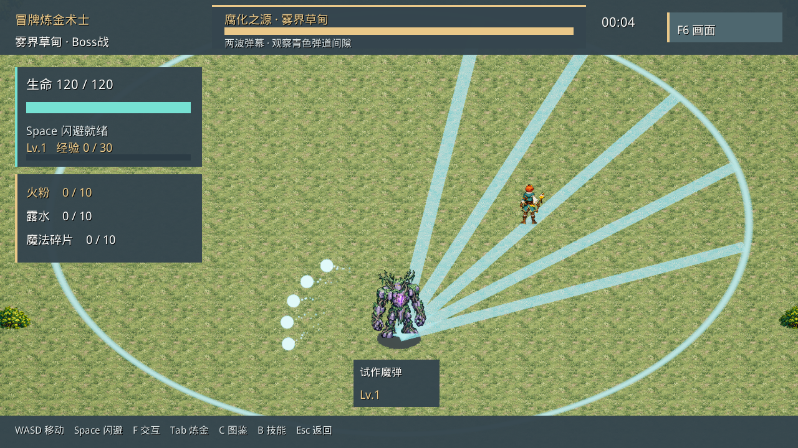

# 关卡策划UE落地记录 · 2026-10-30

用户要求暂停参数问答，先落地已确认设计。本轮已接入当前Greyford完整试玩流程并生成本地Windows包；参数问答保留到第51项确认，第52问淡出时长未作选择。下述临时默认用于可玩测试，不计入已确认规则。

## 试玩入口

- 完整流程：`03_Build/Greyford_BossPlan_Win64_20261030/启动完整试玩.cmd`。村庄出发，外围战斗，5:00开放传送阵，站入后按F确认。
- 快速检查Boss：`03_Build/Greyford_BossPlan_Win64_20261030/直接测试Boss.cmd`。直接进入新Boss场地，使用隔离的临时进度，便于检查移动、读招与躲避；不读取或写入真实成长存档。该入口是初始装备测试，构筑及击杀时长请走完整流程。
- UE主入口：`/Game/Greyford/Maps/Greyford_Flow`。战斗逻辑接在Greyford独立Boss阶段；Research旧原型保留，勿用旧入口判断新规则。

源码和试玩包在本地工作区；本轮未提交或推送工程源码及新包，保留同一工作区其他会话的未提交改动。远端此前的字体90/72旧ZIP不代表本次内容。

## 设计与实现对照

| 范围 | 当前可玩实现 | 验证边界 |
| --- | --- | --- |
| 首次范围技能体验 | 首次教学技能接收并返回战斗后触发近战鼠/泥团小群；合法视野外生成并检查可达性 | 实际点击投料、合成、接收已触发6只；数量6是临时默认；自然游玩40–60秒目标待试玩 |
| 教学缺料保底 | 沿用35秒后补缺；已有地面材料必须可达才视为可用，目标掉落点不可达则使用玩家合法位置 | 新增不可达材料回归通过；不把界面测试给料当作自然掉落平衡证据 |
| 5分钟后的探索 | 沿用数量与刷新频率加压、精英/商人引导、短障碍与退路的当前外围场景 | 压力曲线与资源收益待真人对照；无额外数值冻结 |
| 自选Boss入口 | 5:00开放，随机合法可达落点，箭头引导，阵内F确认 | 已有流程实现与包内回归通过 |
| 入场继承 | 保留生命、技能、冷却；已有地面材料按库存上限回收；场内无补料；胜负前不返回 | 包内检查生命73保持、冷却保持、材料容量截断和不凭空奖励通过 |
| 场地与开场 | 沿用32×26m近椭圆可走区域、中央开阔、上下对位初始10m；2秒准备、玩家可移动、Boss待机、双方不攻击 | 准备期和暂停回归通过；现有美术/镜头沿用，正式美术与平衡仍需验收 |
| 首招 | 直线冲刺/稀疏扇形弹幕各50%抽取；取消此入口的旧三招循环与半血自动增密/加速 | 40个种子覆盖两种首招；概率不要求短期恰好各半 |
| 冲刺预警 | 1秒站定，前0.6秒瞄准、后0.4秒锁定；地面虚线轮廓转实并响一次短音 | 方向保持、暂停后不重复提示通过 |
| 冲刺运动/伤害 | 12m/0.6秒，平均20m/s；总宽2m，结合玩家受击体积扫掠；原始24点；同次最多一次有效伤害，命中继续冲完 | 距离、时长、单次扣血和命中后继续通过；暂用匀速与扫掠端部，曲线/端部正式形状未冻结 |
| 边界与收招 | 触边截短直线位移并结束伤害，不沿边滑行或补足距离；正常/提前结束均原地收招1秒 | 截短及收招通过 |
| 玩家击退 | 有效冲刺命中后沿锁定方向1m/0.15秒，移动接管；正常或受阻结束后恢复当前输入 | 距离、时长、输入恢复、受阻恢复通过；自动攻击/冷却/菜单沿用既有规则 |
| 弹幕发射 | 每招两波、相隔0.8秒；每波5颗、总60°，相对方向−30/−15/0/15/30°；速度大小8m/s、圆形平面判定直径0.6m | 波数、方向、速度、尺寸及分波计数进入实际代码；三维高度与形状仍为工程默认 |
| 第二波 | 第一波后0.5秒按玩家位置重新瞄准并锁定，0.8秒发射；地面五条弹道线及一次短音 | 时点、方向保持和真实D3D12画面通过；具体颜色/音色为测试表现 |
| 弹丸伤害 | 原始18点，减伤后取整；有效伤害后弹丸消失，无敌挡住则继续飞行 | 无敌不消耗弹丸、无敌结束后合法命中、18→14减伤例通过 |
| 波次上限 | 每波对玩家最多一次、两波最多两次；无敌接触不计次数；旧波不因新波/新招/暂停而重获资格 | 同帧多弹、两波共36点原始上限、旧波计数不重置通过 |
| 封顶回收 | 命中弹丸消失，同波剩余立即停伤并短暂淡出回收，另一波照常 | 淡出无伤、暂停冻结、回收通过；时长暂定0.15秒 |

## 未确认参数的本轮测试默认

| 参数 | 本轮默认 | 状态 |
| --- | --- | --- |
| 本波剩余弹丸淡出 | 0.15秒、原地淡出，起点即停伤 | 第52问未回答；时长可在AlchemyWorld的Boss / Unconfirmed Test Defaults中调整 |
| 第一波前摇 | 1.25秒，最后0.3秒锁定；站定施法 | 临时表现，第一波规则未冻结 |
| 弹幕后收招 | 1秒 | 可调测试默认 |
| 弹丸寿命 | 5秒；碰现有场地边界回收 | 可调测试默认，正式射程/寿命/墙界规则未冻结 |
| 飞行方式 | 匀速直线；出生点沿用Boss位置 | 工程测试默认，追踪/出生细节未冻结 |
| 首招之后循环 | 冲刺与扇形弹幕交替 | 可玩测试循环，后续正式节奏未冻结 |
| 教学小群数量 | 6只，合法可达视野外小群 | 可在AlchemyWorld的Level / Unconfirmed Test Defaults中调整，数量未冻结 |
| Boss生命 | 沿用原型6000 | 不作为已通过平衡的正式数值 |

上述编辑器属性可在PIE中选择运行时AlchemyWorld查看和调节。当前打开的编辑器已有本轮核心模块；最后的教学材料可达性函数修正已在独立包编译并验证，运行中编辑器的热载入未得到确认。保留当前未保存地图，结束编辑后常规重编译可确保编辑器模块与源码一致。

## 验证与证据

- 编辑器核心编译通过；独立Win64最终构建、Cook、打包通过。一次新增区域类源文件引起的链接错误已通过重新构建纳入；编辑器开启Live Coding后，最终独立构建使用`-nocompileeditor`保留编辑现场。
- 包内28项生产逻辑检查全部PASS，含不可达教学材料、接收技能排队小群和合法小群生成。
- 原系统`ALCHEMY_SMOKE_PASS`与`ALCH002_TEST_PASS`通过。
- D3D12 1280×720生成准备、冲刺瞄准/锁定、第一波、第二波重瞄、两波飞行、暂停配置7帧；已查看第二波锁定帧。补料可达性修正未改动这部分渲染逻辑。
- D3D12 1024×768完整Greyford流程回归`GREYFORD_FLOW_PASS`通过。
- Computer Use实际点击三种材料→开始炼金→接收“混融酸滴”，返回战斗后日志记录`FIRST_AOE_ENCOUNTER count=6 ... legal_offscreen_cluster=1`。这是隔离界面测试，不是自然40–60秒时点验收。
- 专用0.12秒提示音已导入并接入播放，Niagara沿用现有实际粒子系统；未宣称真人听感、通关率或性能平衡已验收。

结构化结果：[验证记录](场景设计/2026-10-30_Greyford/Boss_雾界草甸/UE/verification.json)。

可复跑：在项目目录执行`Tools/TestBossPlan.ps1`检查规则，追加`-Visual`检查D3D12捕捉。旧Research入口的BossSmoke仍对应旧原型，应与本次入口区分。

## 下一步

暂停逐项参数问答，先试玩当前可玩包，记录“读不清、躲不开、打太久、第一次范围技能是否有变化”四类反馈，再据实调整。工程落地与真人体验验收分别记录。
