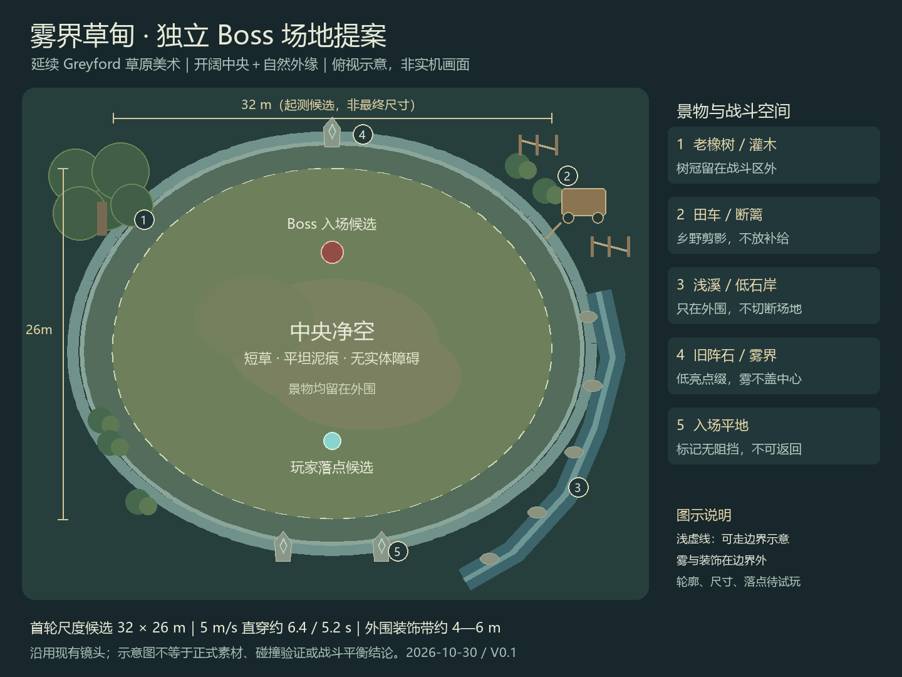

# 1.4关卡

维护位置：Git 仓库中的本文。原 wolai 页面只保留 Git 链接。迁移日期：2026-10-30。已确认规则、历史提案和待验证状态沿用原文，迁移不代表工程实现或平衡验收。

配套记录：[关卡持续确认记录](../关卡策划_持续确认记录.md) · [Boss 场地深化](../场景设计/2026-10-30_Greyford/Boss_雾界草甸/README.md)

> 《冒牌炼金术士》Demo 关卡策划工作台｜2026-10-30最新决定：原地图继续成长，玩家站入传送阵并按交互键确认后进入独立Boss关卡。该设计替代到时原地封圈开战；已确认5:00开放，在随机可达且避开障碍碰撞的位置设置传送阵，并提供UI箭头指引；进入时机由玩家决定，传送保留当前生命且不额外恢复，并按库存上限回收全图已有地面材料，进入后至战斗胜负前不能返回原地图；5分钟后主要通过增加怪物数量和刷新频率明显加快原地图压力增长，鼓励尽早挑战Boss。独立Boss场地采用已确认的“雾界草甸”方案，整体近椭圆、中央无障碍，景物与雾界布置在外围；已确认32×26m可走区域作为首轮测试尺寸，双方固定上下对位已确认，玩家南侧偏内、Boss北侧偏中；双方开场中心点平面间距已确认按10m起测；已确认可操作后2秒准备期并配UI倒计时，允许玩家移动、双方暂不攻击，暂停界面同步暂停计时，结束后自动开战。UI采用屏幕中上方数字与细环，不遮挡Boss血条和双方角色。准备期Boss原地待机，倒计时结束后才移动和攻击；首招从直线冲刺与稀疏扇形弹幕中随机选择一种，抽取权重待第22问确认。Boss战中可调整装备技能并继续炼金，相应界面暂停战斗；场内不补材料，只用入场前积累的材料。此前核对时UE尚未实现这套完整新流程；本轮未重新核对并行工程修改。已确认、源码已有、待讨论、试玩待验收分别标注。

本轮方向确认进度：5/6（约83%）。五个主题方向已确认；Boss补充细则累计确认21项，最新确认首招随机池采用直线冲刺＋稀疏扇形弹幕。已定场地32×26m、固定上下对位、开场中心点平面间距10m、2秒准备期Boss原地待机、中上方数字与细环且不遮挡Boss血条和双方角色；第22问确定两种首招的随机起测比例。UI与攻击参数、边界碰撞、跨关卡状态衔接、结算/重试及试玩验收仍需细化。本进度不是工程完成率或完整策划冻结比例。

进度：83%

### 已确认的最新决定

- 第1问：首次获得范围技能后安排一小群近战怪，让玩家明显感受到清怪变快。状态：用户2026-10-30确认，待UE实现与试玩。

- 沿用：材料组合探索为主、成长爽感为辅，并保留紧张挑战；首次范围炼金目标40–60秒；材料主要靠战斗掉落，首次教学有缺料保底。

- 镜头：沿用回退后的旧视角；不重新采用已被否决的参考透视镜头。

- 第2问已确认（2026-10-30）：为下一次炼金收集材料，精英和商人辅助引导。材料仍主要通过战斗掉落；此决定没有新增固定采集点、任务或固定奖励地点。具体掉落分布、回收路线与商人/精英引导表现仍待细化。

- 第3问已确认（2026-10-30）：用短障碍帮助聚怪和绕行，保留退路。通过绕障整理敌群、范围清怪后回收材料；具体障碍数量、长度、间距、通道宽度和退路位置仍待细化与试玩，本轮未修改UE地图。

- 第4问已确认（2026-10-30）：允许精英和商人同时出现，玩家自主决定先后；不要求商人等待精英被击败，也不强制每次同时刷新。商人可忽略、前往途中正常战斗、交易界面暂停的规则保留。随后第5问改为主动传送Boss关卡，原先按Boss预警离场的商人规则需要重新确认；本轮未修改UE时间表。

- 第5问已确认（2026-10-30）：引导玩家前往Boss关卡传送阵，玩家进入阵内并按交互键确认后传送至独立Boss关卡；玩家可以留在原地图继续提升，也可以选择挑战Boss。该决定替代原地图到时强制封圈开战，不再把5:10强制Boss入场作为新方案。传送阵已确认5:00开放且不强制进入，随机避障可达的落点与UI箭头指引已确认，阵内按交互键确认传送已确认，位置筛选参数及跨关卡衔接规则待细化；状态为已确认方向、待UE实现。

- Boss传送补充第1问已确认（2026-10-30）：有效战斗时间达到5:00（300秒）时开放Boss传送阵；开放后不强制进入，玩家自行决定何时在传送阵内按交互键确认挑战独立Boss关卡，也可以继续留在原地图提升。沿用系统界面暂停战斗计时的规则；不增加精英击杀门槛。传送阵采用随机避障可达位置并配UI箭头；已采用按键确认防止经过时误传送，位置筛选参数及其他衔接规则继续细化，UE尚未实现此流程。

- Boss传送补充第2问已确认（2026-10-30，选择3）：5分钟后，原地图明显加快压力增长，鼓励玩家尽早挑战Boss；玩家仍可自行决定继续成长或进入传送阵。主要加压方式已在补充第3问确认为增加怪物数量和刷新频率；增长速度、间隔、是否设上限及上限值仍待细化；不沿用此前选项1的缓慢增强和封顶方案。状态：策划已确认，待UE实现与试玩。

- Boss传送补充第3问已确认（2026-10-30，选择1）：5分钟后的明显加压主要通过增加怪物数量和刷新频率实现，让更密集的敌群考验范围清怪、聚怪绕行和退路选择。这里只确认主要手段；具体数量、刷新间隔、增长阶梯、存活上限及材料收益仍待细化与试玩，未确认提高单怪生命/伤害或提高精英/远程占比作为主要手段。状态：策划已确认，待UE实现。

- Boss传送补充第4问已确认（2026-10-30，用户自定义）：Boss传送阵采用随机位置，避开障碍物与阻挡碰撞，并提供指向本局传送阵的UI箭头。落点必须位于地图可通行范围，玩家能够走到并站入触发区域；检查传送阵占地和角色站立空间，不能只检查中心点，也不能落在被障碍封闭的孤立空地。随机范围、与玩家的距离限制、净空参数、无合法点时的处理，以及箭头样式/距离显示仍待细化。5:00开放、自主选择进入的规则保留；状态：策划已确认，待UE实现与试玩。

- Boss传送补充第5问已确认（2026-10-30，选择1）：传送阵开放后，玩家站入阵内，按交互键确认才传送至独立Boss关卡；仅经过或停留不自动传送。阵内应有清楚的交互提示，说明可以主动挑战Boss，并在确认前提示进入后至战斗胜负前无法返回。具体按键、切换关卡过程中的受击/暂停与跨关卡状态衔接仍待细化。5:00开放、随机避障可达、UI箭头指引与自主入场的规则保留；状态：策划已确认，待UE实现与试玩。

- Boss传送补充第6问已确认（2026-10-30，选择2）：进入独立Boss关卡时保留传送前的当前生命，不额外恢复。传送不提供部分回血、满血或最低生命保底，也不能因切换关卡默认初始化角色而意外回满。生命继承规则保持；进入后至战斗胜负前不能返回已在补充第7问确认。已持有的剩余材料随行可用于Boss炼金；传送前按库存上限回收全图已有地面材料已在补充第11问确认；技能、金币、冷却等其他携带规则，以及胜负后的结算/重试机制仍待讨论。状态：策划已确认，待UE实现与试玩。

- Boss传送补充第7问已确认（2026-10-30，选择1）：进入独立Boss关卡后，直到战斗胜利或失败前均不能返回原地图；不提供入场后撤回继续成长的机会，正式开战前也不能返回。传送阵的交互提示需在玩家确认进入前说明此限制。击败最终Boss胜利、玩家死亡失败的既有规则保留；胜负后的结算去向与重试流程另行细化。状态：策划已确认，待UE实现与试玩。

- Boss传送补充第8问已确认（2026-10-30，选择1）：Boss战中允许调整已装备的技能，打开技能配置界面时暂停战斗与战斗计时；界面内仍可完成配置操作，关闭后按调整后的配置继续战斗。Boss阶段炼金已在补充第9问确认为允许，炼金界面暂停战斗；技能切换后的冷却处理、具体继承与连锁更新细节仍待细化。状态：策划已确认，待UE实现与试玩。

- Boss传送补充第9问已确认（2026-10-30，选择1）：Boss战中允许继续炼金，打开炼金界面时暂停战斗与战斗计时；投料、查看结果及技能接收沿用既有界面暂停规则，返回战斗后继续。保留已确认的暂停调整装备技能权限。Boss场内不补材料、只用入场前积累的材料已在补充第10问确认；已持有的剩余材料随行可用，全图已有地面材料在传送前按库存上限自动回收；旧清场奖励处理仍待细化。状态：策划已确认，待UE实现与试玩。

- Boss传送补充第10问已确认（2026-10-30，选择3）：Boss场内不补充炼金材料，Boss战炼金只使用入场前积累的材料；入场前已持有的剩余材料随行可用。Boss阶段不安排新增材料补给小怪、血量阶段掉料或场景材料补给。此处确认材料供给规则，不据此决定Boss是否会召唤其他战斗小怪。原地图已有地面材料传送前自动回收且受库存上限限制已确认；旧清场奖励处理仍待定。状态：策划已确认，待UE实现与试玩。

- Boss传送补充第11问已确认（2026-10-30，选择2）：确认传送时，自动回收原地图全图已经掉落的炼金材料，按当前库存容量上限补入背包，再带入Boss关卡；容量不足的部分不带入，不临时突破上限。回收仅涵盖已经生成的材料，不包含存活怪物的潜在掉落；旧清场奖励机制另行处理。此次回收属于入场前已有材料结算，Boss场内仍不补材料。金币、宝箱等其他掉落的处理不在本轮确认范围。状态：策划已确认，待UE实现与试玩。

- Boss传送补充第12问已确认（2026-10-30，选择1）：独立Boss关卡采用开阔场地，中央不放障碍，边界保持清晰；主要通过观察招式和走位躲避Boss攻击。原成长地图中用于聚怪绕行的短障碍规则保持。此次确认布局方向，场地形状、尺寸、玩家与Boss入场位置、边界处理及招式适配仍待细化；不把旧原地战圈半径1450cm当成新场地已定尺寸。状态：策划已确认，待UE实现与试玩。

- Boss场地补充第13问已确认（2026-10-30，选择1）：采用基于格雷弗德新美术的“雾界草甸”方案。整体方向为平顺近椭圆、横向略长的中央净空草地；老橡树、灌木、田车、断篱、浅溪、旧阵石与淡青雾幕置于外围，延续乡野美术，保留当前镜头，不遮挡战斗视野。32×26m已在补充第14问确认作为第一版测试尺寸；具体落点、景物数量/坐标、装饰带尺寸、边界碰撞与招式适配仍需细化及试玩。此确认不新增材料补给、返回功能或剧情设定；状态：方向已确认，待UE实现。

- Boss场地补充第14问已确认（2026-10-30，选择1）：雾界草甸第一版采用32×26m作为可走区域的测试包围尺寸，即宽32m、深26m（3200×2600cm），不包含外围装饰带。沿用平顺近椭圆、中央净空的布局与当前镜头。此确认锁定首轮灰盒起测值，不等于最终平衡尺寸或已完成UE制作；试玩后可以调整。按基础5m/s直穿约6.4/5.2秒，仅作尺度参考。双方固定布局、初始间距及开战流程已随后分别在补充第15—17问确认；具体坐标、边界碰撞与装饰带宽度仍待细化。

- Boss场地补充第15问已确认（2026-10-30，选择1）：独立Boss场地采用固定上下对位，玩家在草图下方（南侧）偏内，Boss在上方（北侧）偏中；双方不按每局随机位置生成，沿用雾界草甸的对峙方向。此处确认布局方式，不冻结草图点位坐标。初始中心点平面间距已在补充第16问确认按10m起测；具体坐标与边界余量仍需按32×26m测试场地和Boss镜头验证，目标是入场能辨认Boss、双方不重叠且保留走位空间。原成长地图Boss传送阵仍采用随机避障可达位置；开战流程与2秒UI倒计时已随后在补充第17问确认；本条布局选择不另行定义无敌机制。状态：策划已确认，待UE实现与试玩。

- Boss场地补充第16问已确认（2026-10-30，选择1）：双方开场按中心点平面距离10m（1000cm）作为第一版测试值，不是两者碰撞边缘的净空距离。沿用32×26m可走区域测试尺寸、固定上下对位：玩家草图南侧偏内，Boss北侧偏中。10m指完成初始摆放时的距离，不要求战斗中持续保持；实际坐标、体型余量和镜头可读性仍需验证。按基础5m/s仅相当于2秒单人直线位移，不代表准备倒计时、安全期或Boss攻击延迟。开战流程已在补充第17问另行确认；状态：测试规格已确认，待UE实现与试玩，试玩后可调整。

- Boss场地补充第17问已确认（2026-10-30，选择1，并要求UI倒计时动画）：画面稳定且玩家可操作后开始2秒准备期，玩家可以移动，双方攻击暂不开始；累计2秒未暂停的准备时间后自动开战。打开已允许的技能配置、炼金及结果界面时，准备计时与战斗一起暂停，关闭后从剩余时间继续。准备期不额外恢复生命，也不开放返回原地图。UI倒计时动画需求已确认，显示方式已在第18问选定中上方数字与细环，具体参数待实机细化；开战时点不等待提示文字淡出。状态：规则已确认，已有交互预览；本轮仅更新策划，UE实现和实机效果尚未在本轮核验。

- Boss场地补充第18问已确认（2026-10-30，选择1）：UI倒计时采用屏幕中上方的数字加细环，必须避开Boss血条及玩家、Boss角色主体；沿用2→1→开战和2秒准备期，暂停配置/炼金界面时计时同步暂停，2秒结束立即开战，不等待提示文字退场。遮挡检查应覆盖2、1和较宽的“开战”文字，并覆盖准备期玩家移动、PC分辨率与窗口比例变化，不能只检查开场静止画面。此次确认显示方式与不遮挡要求；具体锚点、字号、环径、颜色、缓动和避让间距仍需实机细化，不改现行全局字体倍率。状态：策划已确认，本轮未修改UE或重新验收实机画面。

- Boss场地补充第19问已确认（2026-10-30，选择1）：2秒准备期内Boss原地待机，不主动移动，不启动攻击或攻击前摇；玩家仍可移动，双方暂不攻击。倒计时累计2秒未暂停时间后正式开战，Boss此时才进入正常移动与攻击流程；倒计时结束不等于立即造成伤害，也不把准备时间用作提前蓄力。沿用配置/炼金/结果界面暂停准备计时、关闭后续算的规则。未采用准备期缓慢靠近或额外示威动作。首招随机规则已在补充第20问确认，第21问选定直线冲刺与稀疏扇形弹幕；随机权重、前摇与移速仍需细化；状态：策划已确认，本轮仅更新文档，未修改或验收UE。

- Boss场地补充第20问已确认（2026-10-30，选择2）：每次Boss战的第一招从两种基础招式中随机选择一种执行，以增加开场变化。本问确认首招选择规则；两种具体招式已在第21问选定直线冲刺与稀疏扇形弹幕，抽取权重、招式伤害/范围/前摇及后续攻击循环仍待确认。两种首招均遵守已确认的2秒准备期：Boss准备期原地待机，倒计时结束后才启动正常移动与攻击流程，包括攻击前摇。状态：策划已确认，本轮仅更新Git文档，未修改或核验UE实现。

- Boss场地补充第21问已确认（2026-10-30，选择1）：首招随机池采用直线冲刺＋稀疏扇形弹幕，每次Boss战的第一招从这两种中选择一种。直线冲刺以侧向躲开突进路线为主要应对；稀疏扇形弹幕以辨认并利用弹道间隙为主要应对。此确认锁定首招组合，抽取权重、预警/前摇、冲刺速度/距离/宽度、弹幕数量/速度/扇角/间隙及伤害仍需细化；正式表现与怪物策划对齐，后续攻击循环另行设计。沿用2秒准备期Boss原地待机、结束后才启动移动和攻击前摇的规则。状态：策划已确认，本轮只更新文档，未修改或验收UE实现。

### 正在讨论与待验证

- Boss场地补充第22问（待回答）：第一版测试时，两种首招的随机概率如何分配？选项1（推荐）：直线冲刺50%、稀疏扇形弹幕50%，让两种开场获得相近的抽取机会，便于比较体验。选项2：直线冲刺70%、稀疏扇形弹幕30%，更常让玩家练习侧移躲突进。选项3：直线冲刺30%、稀疏扇形弹幕70%，更常让玩家练习观察弹道间隙。本问只确定首招随机抽取的起测比例，试玩后可调整；概率不代表短期局数必须按比例出现，也不决定后续攻击循环或招式强度。当前推荐尚未确认。

- 待细化：教学敌群数量/间距/出现方向/补怪节奏；不把小群敌人等同于必须一击清空。

- 待统一：线上场景档案为随机传送出生，当前Demo为固定中央出生；旧主案及HTML的Boss后继续刷怪已落后于实现。

## 一、核心体验与范围

- Demo为PC单人，当前实现为UE5.8 HD2.5D。最新设计采用原战斗地图成长＋独立Boss关卡挑战：移动与自动战斗 → 拾取材料 → 尝试炼金组合 → 接收/安排技能 → 自选继续成长或站入传送阵按交互键确认挑战Boss。独立Boss关卡尚未实现。

- 体验顺序：先熟悉基础战斗，再明显感到范围技能提高清怪效率，然后增加材料组合选择、成长和生存压力。初次教学不同时讲完所有技能与连锁。

- 胜利条件沿用击败最终Boss，玩家死亡失败。新设计取消原地图定时强制Boss开战，玩家主动传送进入独立Boss关卡；传送阵在5:00开放，玩家决定何时进入；进入后至战斗胜负前不能返回原地图。当前UE仍执行5:00预警、5:10原地封圈，属于待替换实现。

- 本次设计新增独立Boss关卡；不因此扩展其他探索地图、固定采集点或任务链。商人已有实现且可忽略；其他怪物/角色事件仍为讨论提案。

## 二、已确认规则与当前实现

| 主题 | 当前规则 | 状态 |
| --- | --- | --- |
| 首次炼金 | 目标40–60秒有效战斗时间；三类普通材料各1个；全品质结果都具有范围攻击 | 规则已确认；时长体验待试玩 |
| 缺料补给 | 约35秒后，击杀时额外补一个缺少种类；同时考虑库存与合法地面掉落，避免重复补缺 | 源码已有；拾取是否顺畅待试玩 |
| 教学完成 | 首次范围技能单次释放命中至少2个不同敌人；完成永久记录，未完成死亡则下局重试 | 源码已有 |
| 教学试用敌群 | 第一次拿到范围技能后安排一小群近战怪，显著展示清怪提速 | 2026-10-30新确认；待实现 |
| 暂停 | 炼金、结果、升级、交易等界面暂停战斗与战斗计时；展示动画可使用UI时间；新增确认：独立Boss战中可调整装备技能并继续炼金，配置/炼金及结果界面暂停战斗与战斗计时 | 既有界面暂停源码已有；独立Boss配装、炼金及暂停为新确认，待实现与验收 |
| 地图与出生 | 每局读取保存的地图，当前固定中央出生；编辑器随机铺地是制作工具 | 当前实现；线上随机出生设定待统一 |
| 镜头 | 恢复48°俯角、正交投影、2844cm视野宽；编辑器旧45°总览 | 已执行回退；不启用被否决方案 |
| 可读性 | 普通怪无血条，精英保留血条，Boss屏幕偏上血条；伤害数字仍显示 | 既有用户规则；本轮未重新实机验收 |

## 三、成长阶段与自选Boss挑战

时间按有效战斗秒计算，系统界面暂停计时。早期时间段记录已有实现与体验目标；末两行按2026-10-30主动传送的新设计记录，尚未实现。旧5:00预警/5:10强制封圈不作为新方案；传送阵已确认5:00开放且不强制进入，5分钟后明显加快原地图压力增长已确认；主要增加怪物数量和刷新频率，具体增长曲线、存活上限及资源收益待细化。

| 时间 | 已有事件/目标 | 关卡需要提供的体验 | 待验证 |
| --- | --- | --- | --- |
| 0–35秒 | 开局8只普通怪，基础攻击、移动和拾取 | 认识威胁与材料；有可读退路 | 首次接敌压力、材料可见性 |
| 约35秒后 | 开始按击杀补缺 | 缺料能补齐且有机会回收 | 地面可达不等于容易拾到 |
| 40–60秒目标 | 首次三料炼金获得范围技能 | 暂停完成操作；接受技能后进入小群近战怪试用机会 | 不能把目标时长当强制时限 |
| 首次技能接收后 | 新增教学敌群安排（待实现） | 用明显多目标命中表现成长 | 所有品质都能完成至少两敌命中 |
| 70–90秒附近 / 90秒 | 第一位商人窗口 / 第一只精英 | 首次成长后的材料决策和挑战 | 允许并存；商人仍可因教学顺延，验证玩家能否识别并自主选择 |
| 120–180秒 | 混入远程压力；第二商人160–190秒；180秒第二精英 | 尝试绕障、回收和第二轮组合 | 不能只剩逃跑而无法炼金 |
| 180–270秒 | 混合敌群；第三商人255–275秒；270秒第三精英 | 形成有区别的技能组合 | 各组合用途、精英奖励与商人价值 |
| 5:00（300秒有效战斗时间） | 新设计：随机避障可达位置开放Boss传送阵，UI箭头指引；不强制进入 | 自主选择继续成长或挑战Boss | 随机位置与UI箭头已确认；落点净空、路线可达、指向正确、防误触及压力数值待验证 |
| 玩家站入传送阵并按交互键确认后 | 新设计：传送独立Boss关卡，替代原地定时封圈 | 以本局成长挑战Boss，保留当前生命且不额外恢复 | 验证生命原样继承、胜负前不能返回及全图材料回收不超容量；其他携带状态与场地规则待细化 |

当前UE普通波次基线：W0–W5最低目标18/30/45/60/75/90；间隔2.6/2.2/1.9/1.6/1.4/1.35秒；独立批量2/3/4/5/6/6；补充上限8/8/10/10/12/12；普通生成受总存活300上限约束。旧实现Boss入场后停止波次。新方案需支持未传送时继续成长；已确认5分钟后主要增加怪物数量和刷新频率，明显加快压力增长；具体波次、资源收益及压力曲线数值待定，不直接沿用旧终止节点，也不宣称平衡已验收。

当前UE精英在90/180/270秒轮换，旧流程Boss入场后不再执行6:00、7:30精英生成。主动传送新方案下，原地图后续精英刷新是否继续、间隔与收益如何调整尚待确认；保留前段数据作原型参考。

## 四、地图空间与编辑器

- 默认制作规格：24列×18行地面格、每格600cm；工具默认可玩半尺寸7060×5330cm，出生点(0,0)。地表总尺寸、可通行边界和镜头覆盖是不同概念，不混为一项。

- 布局A历史基线：中央48×32设计单位开阔区，外围四组共8段短障碍，保留绕行；1设计单位=100cm。当前保存地图可由设计者手改，本次没有逐格读取二进制地图核实最终位置。

- 随机生成只改变编辑态格子外观与Seed；锁定格保留手工修改，碰撞块独立。每局不会自动重新随机地形。

- 单格图片与材质：Material Override优先于Texture；替换图片时要检查材质覆盖。材质、外观、碰撞分别处理；视觉上是树木不代表必须阻挡。

- 原成长地图的区域职责：已确认短障碍用于聚怪和绕行并保留退路，支持清怪后回收材料。中央承担教学与首次技能试用、外围承担撤退/回收循环仍为候选分工；具体摆放和通道尺寸尚未验收。

- 独立Boss场地（2026-10-30确认）：采用格雷弗德“雾界草甸”方案，整体轮廓平顺、接近椭圆、横向略长，中央净空、边界清晰；橡树、灌木、田车、断篱、浅溪、旧阵石与淡青雾幕布置于外围，原成长地图的短障碍规则保持。32×26m已确认作为第一版可走区域测试尺寸，不含外围装饰带；固定上下对位已确认：玩家南侧偏内、Boss北侧偏中；初始中心点平面间距已确认按10m起测；具体坐标、碰撞与最终平衡尺寸待细化或试玩调整。本轮未改UE关卡。详见下方4.1节。

- 尺寸应对照当前移动能力：基础移速500cm/s，闪避约280cm、持续0.24秒、冷却2秒；成长会影响速度。通道宽度和障碍间距需用实际角色、敌人半径与镜头测量，不仅看格子外观。

### 4.1 独立Boss场地提案：雾界草甸 · 2026-10-30

> 状态更新（2026-10-30）：已确认雾界草甸、32×26m首轮可走区域测试尺寸，以及固定上下对位：玩家草图南侧偏内，Boss北侧偏中。双方初始中心点平面间距已确认10m作为首轮测试值；具体坐标与外围约4—6m装饰带仍待细化；开战流程已确认可操作后2秒准备并配UI倒计时，已选屏幕中上方数字与细环，避开Boss血条和双方角色；具体UI参数待实机细化。Boss准备期原地待机，倒计时结束后才进入正常移动与攻击流程；首招组合已确认直线冲刺＋稀疏扇形弹幕，随机权重待第22问确认。图中点位仅作布局示意，不冻结实际位置；本轮仅更新策划，未制作UE关卡或完成战斗试玩。

设计：格雷弗德外围的一块被雾界围合的草甸。可走轮廓平顺、接近椭圆、横向略长；外侧植被与溪岸形成自然变化，中央冷绿短草与平坦泥痕保留清楚的躲招空间。“雾界草甸”为暂名，雾幕与Boss的剧情关系尚未确认。

| 位置 | 景物安排 | 战斗边界 |
| --- | --- | --- |
| 中央 | 低对比短草、少量压实泥地和浅车辙 | 全部可通行；泥痕不新增减速、伤害或采集玩法 |
| 西北外围 | 一棵老橡树、小簇灌木 | 树干树冠都在战斗区外；检查斜俯视投影，避免挡角色 |
| 东侧外围 | 弃置田车、两段旧木篱 | 只作乡野剪影，不伸入内场形成卡点，不提供材料 |
| 东南外围 | 浅溪与低石岸 | 水在可走区域外，不切开内场、不形成必经窄桥 |
| 北侧外围 | 一块低亮度旧阵石 | 提供方位参照，不抢Boss轮廓与危险预警 |
| 南侧 | 平坦泥草落点，阵石在外侧 | 标记不挡路，也不提供返回功能；近镜头侧只放低矮景物 |
| 边界 | 低草岸、灰石、淡青雾幕 | 外观自然、可走轮廓平顺，无凹袋；视觉提示与实际阻挡对齐 |

画面层次：中央草更短、花更少、纹理对比更低；环境比普通草原略冷，外围雾聚拢，战斗平面清楚。阵石仅小面积青光，强对比留给角色和危险预警。中央不放高台、大石圈或满地发光符号。图中线条仅解释边界，不要求实机画成发光圆圈。

灰盒测试尺寸已确认（2026-10-30，补充第14问）：可走区域平面包围尺寸为32m×26m，沿用近椭圆净空布局。外围约4—6m装饰带仍是候选，不计入32×26m；玩家南侧偏内、Boss北侧偏中的固定上下对位已确认，初始中心点平面间距已确认10m起测，实际坐标待细化。按5m/s粗算直穿约6.4/5.2秒，不能据此宣称平衡。28×24m、38×30m为未采用的历史备选；当前先按32×26m测试，必要时依据试玩结果调整。

镜头依据修正（2026-10-30源码核对）：ViewWidth默认2844cm用于普通战斗；UpdateCamera在bBossArenaActive时实际采用max(ViewWidth,3600cm)，并将目标点设为BossArenaCenter后进行边界约束，因此不能直接用28.44m普通镜头推断Boss场地的可见范围。固定斜俯视方向保留，本轮不改镜头程序。32×26m新场地及双方间距需在实际Boss镜头、屏幕比例、边界约束和HUD遮挡下验证；此为代码核对，不是新场地同屏或读招试玩通过。

| 复用素材 | 本场用途 | 当前状态 |
| --- | --- | --- |
| Grass / Dirt | 短草地、踩实泥地 | 已有材质；Grass自动拼接通过，Dirt待美术复查 |
| Oak / Bush / RuneStone | 外缘地标、植被、阵石 | P1已应用于独立草原灰盒，仍为首版素材 |
| Water / Stone | 外缘溪流与石岸基础 | 已有材质；平铺待复查，石路不等于已有石岸模型 |
| Cart / Fence | 外围田车和木篱 | P2已导入库，场景部分仍为灰盒占位，需适配摆放 |

新增或调整需求：外围雾幕、稀疏短草变体、泥草过渡；未宣称已有可直接用的Niagara雾系统或混合材质。现有材质在/Game/Greyford/Materials/M_GF_*。外观与碰撞分别制作，树贴片整张矩形不可直接代替树干碰撞。

玩法沿用：独立Boss关卡，原地图5:00开放随机避障可达传送阵，UI箭头与阵内按交互键确认；传送前按库存上限回收全图已有材料，保留当前生命且不回血。入场后至胜负前不能返回；可暂停配置技能与炼金，场内不补材料。因此田车、草木、阵石不配置材料宝箱或可采集资源。是否召唤非补给用途的战斗小怪仍待Boss设计决定。

- 验收1：正式角色沿中央及边界连续走位、闪避，检查景物卡点、凹角、树冠和南缘前景遮挡。

- 验收2：按已确认的32×26m首轮测试尺寸，用正式Boss招式与角色测试前摇、Boss轮廓、拉远后的视野和躲避空间；尚未试玩，草图不证明平衡。

- 验收3：雾、树影、地面、阵石与危险预警同屏仍易区分；场景没有新增材料补给或诱导采集的装饰。

**美术依据：**[村庄外围（第一关）](https://github.com/QIQIdeqi/MPLJSS/blob/main/00_Doc/%E5%8D%8F%E4%BD%9C%E7%AD%96%E5%88%92/%E5%9C%BA%E6%99%AF_%E6%9D%91%E5%BA%84%E5%A4%96%E5%9B%B4_%E7%AC%AC%E4%B8%80%E5%85%B3.md)；[格雷弗德边境村庄](https://github.com/QIQIdeqi/MPLJSS/blob/main/00_Doc/%E5%8D%8F%E4%BD%9C%E7%AD%96%E5%88%92/%E5%9C%BA%E6%99%AF_%E6%A0%BC%E9%9B%B7%E5%BC%97%E5%BE%B7%E8%BE%B9%E5%A2%83%E6%9D%91%E5%BA%84.md)。已查看2026-10-30概念图、V2布局与素材图。旧scene-proposal.json中在大草甸临时划战圈的条件性提议由已确认的独立Boss关卡替代；本轮未改原场景档案与剧情。

[Boss_雾界草甸_V01_设计提案.md](附件/53qcxEAzKDxfSeQ1Lny3iP_Boss_雾界草甸_V01_设计提案.md)

V0.1初始提案快照（本次方向确认前）；最新确认状态与尺寸待定事项以本页正文为准。

SSD完整方案与草图：00_Doc/场景设计/2026-10-30_Greyford/Boss_雾界草甸/。问答与进度继续记录在1.4关卡及关卡策划_持续确认记录.md；本轮未修改UE代码、关卡、镜头或构建包，未Git推送。

## 五、首次范围技能的体验场景

用户确认原话：『选1，安排一小群近战怪，让玩家明显感受到范围技能清怪变快。』确认日期：2026-10-30。该决定已记录，尚未修改UE。

- 触发建议：玩家接收首次范围技能并返回战斗后安排机会，而不是仅凭40或60秒定时强行触发。此为配套建议，具体触发与补怪规则待细化。

- 空间建议：使用玩家附近可达开阔处；敌群从可读方向接近，距离容易聚拢；短暂减缓其他方向补怪。具体数量、方向、间距与时长未定；不传送玩家或凭空删除现有敌人。

- 体验目标：同一技能释放能看见多个敌人受击，和之前单目标攻击形成对比。至少两敌命中沿用原教学条件；是否击杀与击杀数量需按技能品质、敌人血量试玩。

- 待验证：低/中/高三种教学结果都能完成；初始技能不会提前拆散全部试用目标；玩家在地图边缘、障碍旁或教学较晚时也有可达机会。

## 六、材料、技能与遭遇的衔接

| 组合 | 当前原型用途 | 关卡需要检验 |
| --- | --- | --- |
| 仅火粉 | 持续单体输出 | 对精英/Boss的实际持续输出 |
| 仅露水 | 近身减速与脱困 | 近身压力下能否获得退路 |
| 仅魔法碎片 | 疏散敌群清理 | 分散目标的搜索和跳跃收益 |
| 火粉+露水 | 常规范围清群 | 普通密集群体的清理效率 |
| 火粉+魔法碎片 | 远程集中爆破 | 远处敌群是否构成独立使用场景 |
| 露水+魔法碎片 | 近身持续控场 | 与纯露水的体验是否足够不同 |
| 三类齐全 | 通用范围攻击/首次教学 | 全品质的多目标命中机会 |

当前系统关联：七组普通组合、21个普通技能、3个精英专属技能及初始技能；普通投料3–10个，教学首次各1个；6装备位/6储备位；新十组连锁替换旧两组。组合用途与品质递进已按原型候选接入，不能据此宣称平衡完成。

- 材料主要来自战斗。当前普通库存每种通常上限10；精英箱产出专属与普通材料，受容量约束；单次炼金最多10个。旧Boss清场补给允许临时超容量。新设计已确认传送前自动回收全图已有地面材料，受库存容量限制，不沿用旧临时超容量回收；旧清场奖励处理仍待定。 新设计已确认Boss场内不补炼金材料，只消耗入场前积累的材料；已持有的剩余材料随行可用。

- 当前UE商人每局至多三位，停留35战斗秒，教学未完成顺延，相邻至少60秒；三个货位允许重复但至少两种；买卖用本局金币，刷新5/10/15/20/25封顶，交易暂停。精英/商人允许并存的决定保留。旧实现300秒Boss预警时商人离场；主动传送方案下，开放后是否继续出现以及何时离场待确认，经济参数仍未平衡验收。

- Boss新方向：玩家站入传送阵并按交互键确认后进入独立Boss关卡，自选挑战时机；经过或停留不会自动传送。新设计允许Boss战中调整装备技能并继续炼金，配置/炼金及结果界面暂停战斗与战斗计时。独立Boss场地已确认采用“雾界草甸”近椭圆净空布局，首轮测试尺寸已确认32×26m，玩家南侧偏内、Boss北侧偏中的固定上下对位已确认，开场中心点平面间距已确认10m起测，具体坐标与边界碰撞待细化。当前UE仍在玩家位置建立半径1450cm战圈，并保留原地图障碍/边界，这套场地流程待替换；冲刺、扇形弹幕、直线冲击波和半血阶段已有实现，可作为独立场地试玩输入，招式与场地适配仍待验收。

## 七、文档差异与待确认

| 差异/遗漏 | 当前证据 | 处理原则 |
| --- | --- | --- |
| Boss流程版本变化 | 旧稿继续刷怪；当前UE定时清场封圈；最新设计为主动传送独立Boss关卡 | 新设计优先；原图继续成长的波次及清场奖励待重订，UE尚未修改 |
| 旧首次教学时间表 | 旧HTML仅写首分钟尝试；ALCH-002已有35秒补缺和40–60秒目标 | 补齐教学遭遇，体验目标须试玩 |
| 商人与精英窗口重叠 | 70–90/160–190/255–275与90/180/270接近 | 已确认允许重叠、由玩家决定先后；验证提示是否清楚与选择是否可行，不再把强制错峰作为默认方案 |
| 独立Boss场地待设计 | 当前UE在玩家位置封圈，受原地图边缘和障碍影响 | 新设计采用“雾界草甸”独立Boss场地，平顺近椭圆、中央无障碍的整体方向已确认；传送阵随机避障可达并有UI箭头已确认，可走区域32×26m起测尺寸已确认；固定上下对位已确认，开场中心点平面间距已确认10m起测，入场坐标、碰撞与其余衔接参数待细化 |
| 线上随机出生 vs Demo中央出生 | wolai《村庄外围（第一关）》写随机传送；当前Demo固定中央 | 待用户统一适用范围；保留原场景文案 |
| 场景名称 | 线上场景档案为村庄外围；本地运行提示为腐化林地 | 待确认叙事名与显示名是否统一 |
| 随机铺地 vs 体验设计 | 工具可以铺外观，不自动生成教学、路线与节奏 | 每个区域明确体验职责后再细化美术 |

场景美术依据（2026-10-30实读）：村庄外围 https://github.com/QIQIdeqi/MPLJSS/blob/main/00_Doc/%E5%8D%8F%E4%BD%9C%E7%AD%96%E5%88%92/%E5%9C%BA%E6%99%AF_%E6%9D%91%E5%BA%84%E5%A4%96%E5%9B%B4_%E7%AC%AC%E4%B8%80%E5%85%B3.md 与格雷弗德村庄 https://github.com/QIQIdeqi/MPLJSS/blob/main/00_Doc/%E5%8D%8F%E4%BD%9C%E7%AD%96%E5%88%92/%E5%9C%BA%E6%99%AF_%E6%A0%BC%E9%9B%B7%E5%BC%97%E5%BE%B7%E8%BE%B9%E5%A2%83%E6%9D%91%E5%BA%84.md ，并查看对应概念图、V2俯视布局与共享素材图。Boss场地延续草原、旧木、溪岸、淡青雾界语言；不把透视概念图当成实机镜头，不覆盖既有剧情。

## 八、一问一答与待办

| 主题 | 状态 | 记录 |
| --- | --- | --- |
| 1. 首次技能体验 | 方向已确认 | 小群近战怪展示范围技能清怪提速；具体参数待细化 |
| 2. 玩家移动动机 | 方向已确认 | 为下一次炼金收集材料；精英和商人辅助引导（2026-10-30） |
| 3. 障碍分工 | 方向已确认 | 短障碍帮助聚怪和绕行，保留退路（2026-10-30）；具体尺度待细化 |
| 4. 精英/商人节奏 | 方向已确认 | 精英与商人允许同时出现，玩家自主决定先后（2026-10-30） |
| 5. Boss空间 | 方向已确认；传送细则待定 | 5:00开放传送阵；此后原地图明显加快压力增长，玩家自选挑战Boss或继续成长 |
| 6. 试玩验收 | 待讨论 | 观察行为、记录时间、判定是否达到体验目标 |

第2问已确认（2026-10-30）：为下一次炼金收集材料，精英和商人辅助引导。材料仍主要通过战斗掉落；此决定没有新增固定采集点、任务或固定奖励地点。具体掉落分布、回收路线与商人/精英引导表现仍待细化。

第3问已确认（2026-10-30）：用短障碍帮助聚怪和绕行，保留退路。通过绕障整理敌群、范围清怪后回收材料；具体障碍数量、长度、间距、通道宽度和退路位置仍待细化与试玩，本轮未修改UE地图。

第4问已确认（2026-10-30）：允许精英和商人同时出现，玩家自主决定先后；不要求商人等待精英被击败，也不强制每次同时刷新。商人可忽略、前往途中正常战斗、交易界面暂停的规则保留。随后第5问改为主动传送Boss关卡，原先按Boss预警离场的商人规则需要重新确认；本轮未修改UE时间表。

第5问已确认（2026-10-30）：引导玩家前往Boss关卡传送阵，玩家进入阵内并按交互键确认后传送至独立Boss关卡；玩家可以留在原地图继续提升，也可以选择挑战Boss。该决定替代原地图到时强制封圈开战，不再把5:10强制Boss入场作为新方案。传送阵已确认5:00开放且不强制进入，随机避障可达的落点与UI箭头指引已确认，阵内按交互键确认传送已确认，位置筛选参数及跨关卡衔接规则待细化；状态为已确认方向、待UE实现。

Boss传送设计边界：原地图承担战斗、材料回收和炼金成长；传送阵提供主动挑战入口；独立Boss场地已确认采用“雾界草甸”，轮廓平顺近椭圆、中央无障碍、边界清晰，首轮可走区域测试尺寸已确认32×26m，固定上下对位与10m开场中心点平面测试间距已确认，具体坐标与碰撞待细化。已确认5分钟后明显加快原地图压力增长，玩家自行权衡继续成长与挑战Boss；主要加压方式已确认为增加怪物数量和刷新频率；数值、存活上限及资源收益尚待细化。Boss战允许调整已有装备技能，配置界面暂停战斗与战斗计时；Boss阶段允许炼金，炼金及结果界面暂停战斗与战斗计时；场内不补材料，只用入场前积累。应衔接本局构筑来体现成长价值；当前生命已确认原样继承且不额外恢复；已持有的剩余炼金材料随行可用；传送前按库存上限回收全图已有地面材料已确认；金币、技能等级、冷却等其他携带/重置规则尚未确认。进入后至战斗胜负前不能返回原地图已确认；是否沿用旧清场奖励、胜负后的结算/重试与商人离场节点仍待确认；不擅自增加传送费用、强制进入Boss的限时倒计时或精英击杀门槛。入场后的2秒准备期见补充第17问，不构成原地图强制入场时限。

Boss传送补充第1问已确认（2026-10-30）：有效战斗时间达到5:00（300秒）时开放Boss传送阵；开放后不强制进入，玩家自行决定何时在传送阵内按交互键确认挑战独立Boss关卡，也可以继续留在原地图提升。沿用系统界面暂停战斗计时的规则；不增加精英击杀门槛。传送阵采用随机避障可达位置并配UI箭头；已采用按键确认防止经过时误传送，位置筛选参数及其他衔接规则继续细化，UE尚未实现此流程。

Boss传送补充第2问已确认（2026-10-30，选择3）：5分钟后，原地图明显加快压力增长，鼓励玩家尽早挑战Boss；玩家仍可自行决定继续成长或进入传送阵。主要加压方式已在补充第3问确认为增加怪物数量和刷新频率；增长速度、间隔、是否设上限及上限值仍待细化；不沿用此前选项1的缓慢增强和封顶方案。状态：策划已确认，待UE实现与试玩。

Boss传送补充第3问已确认（2026-10-30，选择1）：5分钟后的明显加压主要通过增加怪物数量和刷新频率实现，让更密集的敌群考验范围清怪、聚怪绕行和退路选择。这里只确认主要手段；具体数量、刷新间隔、增长阶梯、存活上限及材料收益仍待细化与试玩，未确认提高单怪生命/伤害或提高精英/远程占比作为主要手段。状态：策划已确认，待UE实现。

Boss传送补充第4问已确认（2026-10-30，用户自定义）：Boss传送阵采用随机位置，避开障碍物与阻挡碰撞，并提供指向本局传送阵的UI箭头。落点必须位于地图可通行范围，玩家能够走到并站入触发区域；检查传送阵占地和角色站立空间，不能只检查中心点，也不能落在被障碍封闭的孤立空地。随机范围、与玩家的距离限制、净空参数、无合法点时的处理，以及箭头样式/距离显示仍待细化。5:00开放、自主选择进入的规则保留；状态：策划已确认，待UE实现与试玩。

Boss传送补充第5问已确认（2026-10-30，选择1）：传送阵开放后，玩家站入阵内，按交互键确认才传送至独立Boss关卡；仅经过或停留不自动传送。阵内应有清楚的交互提示，说明可以主动挑战Boss，并在确认前提示进入后至战斗胜负前无法返回。具体按键、切换关卡过程中的受击/暂停与跨关卡状态衔接仍待细化。5:00开放、随机避障可达、UI箭头指引与自主入场的规则保留；状态：策划已确认，待UE实现与试玩。

Boss传送补充第6问已确认（2026-10-30，选择2）：进入独立Boss关卡时保留传送前的当前生命，不额外恢复。传送不提供部分回血、满血或最低生命保底，也不能因切换关卡默认初始化角色而意外回满。生命继承规则保持；进入后至战斗胜负前不能返回已在补充第7问确认。已持有的剩余材料随行可用于Boss炼金；传送前按库存上限回收全图已有地面材料已在补充第11问确认；技能、金币、冷却等其他携带规则，以及胜负后的结算/重试机制仍待讨论。状态：策划已确认，待UE实现与试玩。

Boss传送补充第7问已确认（2026-10-30，选择1）：进入独立Boss关卡后，直到战斗胜利或失败前均不能返回原地图；不提供入场后撤回继续成长的机会，正式开战前也不能返回。传送阵的交互提示需在玩家确认进入前说明此限制。击败最终Boss胜利、玩家死亡失败的既有规则保留；胜负后的结算去向与重试流程另行细化。状态：策划已确认，待UE实现与试玩。

Boss传送补充第8问已确认（2026-10-30，选择1）：Boss战中允许调整已装备的技能，打开技能配置界面时暂停战斗与战斗计时；界面内仍可完成配置操作，关闭后按调整后的配置继续战斗。Boss阶段炼金已在补充第9问确认为允许，炼金界面暂停战斗；技能切换后的冷却处理、具体继承与连锁更新细节仍待细化。状态：策划已确认，待UE实现与试玩。

Boss传送补充第9问已确认（2026-10-30，选择1）：Boss战中允许继续炼金，打开炼金界面时暂停战斗与战斗计时；投料、查看结果及技能接收沿用既有界面暂停规则，返回战斗后继续。保留已确认的暂停调整装备技能权限。Boss场内不补材料、只用入场前积累的材料已在补充第10问确认；已持有的剩余材料随行可用，全图已有地面材料在传送前按库存上限自动回收；旧清场奖励处理仍待细化。状态：策划已确认，待UE实现与试玩。

Boss传送补充第10问已确认（2026-10-30，选择3）：Boss场内不补充炼金材料，Boss战炼金只使用入场前积累的材料；入场前已持有的剩余材料随行可用。Boss阶段不安排新增材料补给小怪、血量阶段掉料或场景材料补给。此处确认材料供给规则，不据此决定Boss是否会召唤其他战斗小怪。原地图已有地面材料传送前自动回收且受库存上限限制已确认；旧清场奖励处理仍待定。状态：策划已确认，待UE实现与试玩。

Boss传送补充第11问已确认（2026-10-30，选择2）：确认传送时，自动回收原地图全图已经掉落的炼金材料，按当前库存容量上限补入背包，再带入Boss关卡；容量不足的部分不带入，不临时突破上限。回收仅涵盖已经生成的材料，不包含存活怪物的潜在掉落；旧清场奖励机制另行处理。此次回收属于入场前已有材料结算，Boss场内仍不补材料。金币、宝箱等其他掉落的处理不在本轮确认范围。状态：策划已确认，待UE实现与试玩。

Boss传送补充第12问已确认（2026-10-30，选择1）：独立Boss关卡采用开阔场地，中央不放障碍，边界保持清晰；主要通过观察招式和走位躲避Boss攻击。原成长地图中用于聚怪绕行的短障碍规则保持。此次确认布局方向，场地形状、尺寸、玩家与Boss入场位置、边界处理及招式适配仍待细化；不把旧原地战圈半径1450cm当成新场地已定尺寸。状态：策划已确认，待UE实现与试玩。

Boss场地补充第13问已确认（2026-10-30，选择1）：采用基于格雷弗德新美术的“雾界草甸”方案。整体方向为平顺近椭圆、横向略长的中央净空草地；老橡树、灌木、田车、断篱、浅溪、旧阵石与淡青雾幕置于外围，延续乡野美术，保留当前镜头，不遮挡战斗视野。32×26m已在补充第14问确认作为第一版测试尺寸；具体落点、景物数量/坐标、装饰带尺寸、边界碰撞与招式适配仍需细化及试玩。此确认不新增材料补给、返回功能或剧情设定；状态：方向已确认，待UE实现。

Boss场地补充第14问已确认（2026-10-30，选择1）：雾界草甸第一版采用32×26m作为可走区域的测试包围尺寸，即宽32m、深26m（3200×2600cm），不包含外围装饰带。沿用平顺近椭圆、中央净空的布局与当前镜头。此确认锁定首轮灰盒起测值，不等于最终平衡尺寸或已完成UE制作；试玩后可以调整。按基础5m/s直穿约6.4/5.2秒，仅作尺度参考。双方固定布局、初始间距及开战流程已随后分别在补充第15—17问确认；具体坐标、边界碰撞与装饰带宽度仍待细化。

Boss场地补充第15问已确认（2026-10-30，选择1）：独立Boss场地采用固定上下对位，玩家在草图下方（南侧）偏内，Boss在上方（北侧）偏中；双方不按每局随机位置生成，沿用雾界草甸的对峙方向。此处确认布局方式，不冻结草图点位坐标。初始中心点平面间距已在补充第16问确认按10m起测；具体坐标与边界余量仍需按32×26m测试场地和Boss镜头验证，目标是入场能辨认Boss、双方不重叠且保留走位空间。原成长地图Boss传送阵仍采用随机避障可达位置；开战流程与2秒UI倒计时已随后在补充第17问确认；本条布局选择不另行定义无敌机制。状态：策划已确认，待UE实现与试玩。

Boss场地补充第16问已确认（2026-10-30，选择1）：双方开场按中心点平面距离10m（1000cm）作为第一版测试值，不是两者碰撞边缘的净空距离。沿用32×26m可走区域测试尺寸、固定上下对位：玩家草图南侧偏内，Boss北侧偏中。10m指完成初始摆放时的距离，不要求战斗中持续保持；实际坐标、体型余量和镜头可读性仍需验证。按基础5m/s仅相当于2秒单人直线位移，不代表准备倒计时、安全期或Boss攻击延迟。开战流程已在补充第17问另行确认；状态：测试规格已确认，待UE实现与试玩，试玩后可调整。

Boss场地补充第17问已确认（2026-10-30，选择1，并要求UI倒计时动画）：画面稳定且玩家可操作后开始2秒准备期，玩家可以移动，双方攻击暂不开始；累计2秒未暂停的准备时间后自动开战。打开已允许的技能配置、炼金及结果界面时，准备计时与战斗一起暂停，关闭后从剩余时间继续。准备期不额外恢复生命，也不开放返回原地图。UI倒计时动画需求已确认，显示方式已在第18问选定中上方数字与细环，具体参数待实机细化；开战时点不等待提示文字淡出。状态：规则已确认，已有交互预览；本轮仅更新策划，UE实现和实机效果尚未在本轮核验。

UI表现状态（补充第18问已确认方向）：采用屏幕中上方数字与细环，按2→1→开战展示准备过程；Boss血条与双方角色不能被覆盖，2秒结束即进入战斗，开战文字退场不能增加准备时间。中央纯数字与顶部短横条保留为未采用的历史备选。已有预览支持重播、暂停/继续、减少动态效果及字号调节；预览中的像素位置、字号、环径、配色和缓动仍是候选，不更改现行游戏全局字体倍率。文件：00_Doc/场景设计/2026-10-30_Greyford/Boss_雾界草甸/UI/boss-countdown.html。角色与地形只是站位示意，不是UE截图或按比例场地图。本轮只更新策划记录，沿用已有预览。

Boss场地补充第18问已确认（2026-10-30，选择1）：UI倒计时采用屏幕中上方的数字加细环，必须避开Boss血条及玩家、Boss角色主体；沿用2→1→开战和2秒准备期，暂停配置/炼金界面时计时同步暂停，2秒结束立即开战，不等待提示文字退场。遮挡检查应覆盖2、1和较宽的“开战”文字，并覆盖准备期玩家移动、PC分辨率与窗口比例变化，不能只检查开场静止画面。此次确认显示方式与不遮挡要求；具体锚点、字号、环径、颜色、缓动和避让间距仍需实机细化，不改现行全局字体倍率。状态：策划已确认，本轮未修改UE或重新验收实机画面。

Boss场地补充第19问已确认（2026-10-30，选择1）：2秒准备期内Boss原地待机，不主动移动，不启动攻击或攻击前摇；玩家仍可移动，双方暂不攻击。倒计时累计2秒未暂停时间后正式开战，Boss此时才进入正常移动与攻击流程；倒计时结束不等于立即造成伤害，也不把准备时间用作提前蓄力。沿用配置/炼金/结果界面暂停准备计时、关闭后续算的规则。未采用准备期缓慢靠近或额外示威动作。首招随机规则已在补充第20问确认，第21问选定直线冲刺与稀疏扇形弹幕；随机权重、前摇与移速仍需细化；状态：策划已确认，本轮仅更新文档，未修改或验收UE。

Boss场地补充第20问已确认（2026-10-30，选择2）：每次Boss战的第一招从两种基础招式中随机选择一种执行，以增加开场变化。本问确认首招选择规则；两种具体招式已在第21问选定直线冲刺与稀疏扇形弹幕，抽取权重、招式伤害/范围/前摇及后续攻击循环仍待确认。两种首招均遵守已确认的2秒准备期：Boss准备期原地待机，倒计时结束后才启动正常移动与攻击流程，包括攻击前摇。状态：策划已确认，本轮仅更新Git文档，未修改或核验UE实现。

首招候选依据（第20问，2026-10-30当时核对）：本地关卡文档已有冲刺、扇形弹幕、直线冲击波的原型记录，当时据此提出组合候选，未重新核验UE实现或场地适配。第20问只读查看wolai[1.3怪物](https://www.wolai.com/gwe64s5MkLehJREoikx9dX)，当时直接子页为哥布林和史莱姆；此依据不指定独立Boss身份，也不改写怪物正文。

Boss场地补充第21问已确认（2026-10-30，选择1）：首招随机池采用直线冲刺＋稀疏扇形弹幕，每次Boss战的第一招从这两种中选择一种。直线冲刺以侧向躲开突进路线为主要应对；稀疏扇形弹幕以辨认并利用弹道间隙为主要应对。此确认锁定首招组合，抽取权重、预警/前摇、冲刺速度/距离/宽度、弹幕数量/速度/扇角/间隙及伤害仍需细化；正式表现与怪物策划对齐，后续攻击循环另行设计。沿用2秒准备期Boss原地待机、结束后才启动移动和攻击前摇的规则。状态：策划已确认，本轮只更新文档，未修改或验收UE实现。

Boss场地补充第22问（待回答）：第一版测试时，两种首招的随机概率如何分配？选项1（推荐）：直线冲刺50%、稀疏扇形弹幕50%，让两种开场获得相近的抽取机会，便于比较体验。选项2：直线冲刺70%、稀疏扇形弹幕30%，更常让玩家练习侧移躲突进。选项3：直线冲刺30%、稀疏扇形弹幕70%，更常让玩家练习观察弹道间隙。本问只确定首招随机抽取的起测比例，试玩后可调整；概率不代表短期局数必须按比例出现，也不决定后续攻击循环或招式强度。当前推荐尚未确认。

- 验收候选：记录第一次接敌、三料齐备、打开炼金、接收技能、首次双目标命中时间；观察新手能否说出清怪为何变快。记录的是正常流程，不以隔离测试替代。

- 验收候选：在中央、边缘、障碍旁与狭窄通道附近观察材料回收和传送阵随机落点；确认入口占地与站立空间无阻挡、玩家确实能走到并站入，排除孤立空地。移动玩家/镜头后检查UI箭头仍正确指向本局入口。检查仅阵内按交互键可触发传送，经过、停留或阵外按键均不误触；检查满血、半血、低血量进入时当前生命均原样继承，没有传送回血或角色重建导致回满；检查确认传送前已提示不可返回，进入后在战斗胜负前不能撤回原地图；检查Boss战中配置界面可操作，战斗行为、弹幕与战斗计时暂停，关闭后按调整后的配置继续战斗；检查Boss战中有足够材料时可完成投料、结果处理与技能接收，相关界面期间战斗及计时暂停，返回战斗后继续；检查已持有剩余材料正确带入，全图已有地面材料在传送时按库存上限回收且不重复入账，库存满时不超容量；Boss场内没有新增材料补给；材料耗尽后不能免费炼金，仍可使用和调整已有技能；检查其他跨关卡状态衔接；检查独立Boss场地中央通行无阻挡、边界清楚，以及冲刺/弹幕下的可读躲避空间；成长压力与资源收益也需试玩，具体通过阈值待确认。

## 九、来源与更新规则

本地来源：00_Doc/冒牌炼金术士_Demo关卡策划案_V0.1.md；00_Doc/关卡可视化/index.html；00_Doc/系统/ALCH-002_规则确认与实施补充.md；ALCH-002_技能分配草案.md；局内突发事件与商人方案_2026-10-29.txt；02_Prototype/AlchemyHD2D/Docs/BossEncounter.md、Merchant.md；UE关卡与技能编辑器使用说明.md。

实现核对入口：AlchemyWorld.cpp 的 TutorialSupply/TutorialHit/AcceptPendingResult/SpawnWave/FindSpawnPoint/Tick；AlchemyBoss.inl 的 StartBossEncounter；AlchemyMerchant.inl 的 SpawnMerchant/UpdateMerchant；AlchemyDesignTools.cpp 的 Randomize/GenerateFromSeed。没有把文档提案或历史自动测试当成本轮正常流程试玩结果。

后续每轮问答同步（2026-10-30按用户新安排）：收到确认后，在当轮回复结束前将选择、确认日期、进度、未定参数和下一问写入Git正文00_Doc/协作策划/1.4关卡.md及配套持续记录，提交并核对远端内容；wolai的1.4关卡只保留Git文档链接，不再追加正文。若发布失败明确告知，不声称已同步；不设置后台定时任务。新决定与旧条目冲突时标明替代关系；推荐不自动算已确认，确认不自动算已实现，试玩证据单独记录。

本次建立关卡策划栏目并汇总规划；仅更新文档与本地记录，没有修改UE程序、地图资产或执行Git推送。
