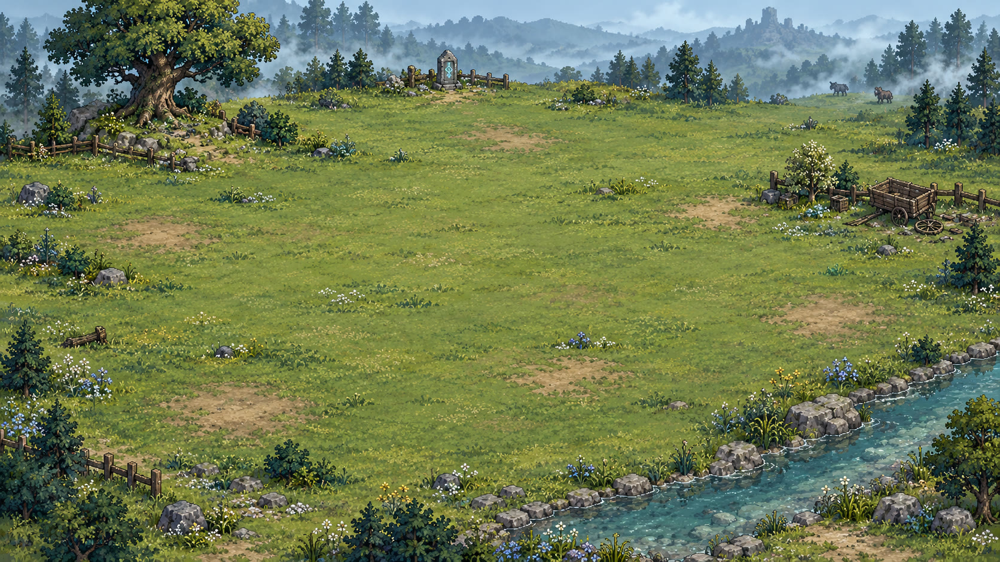
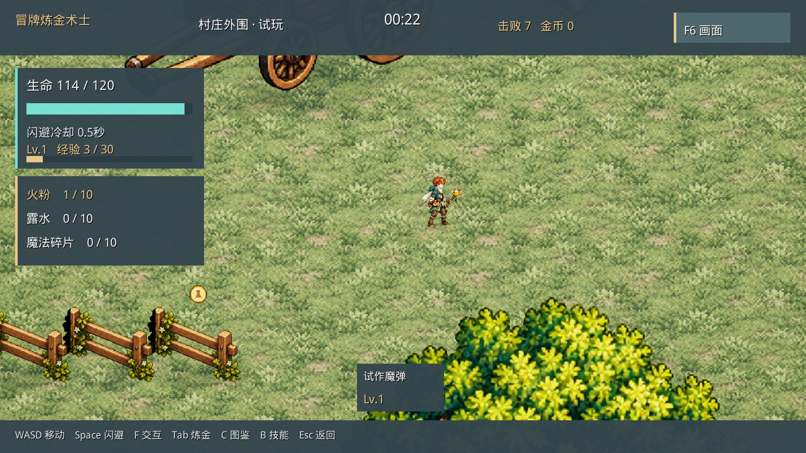
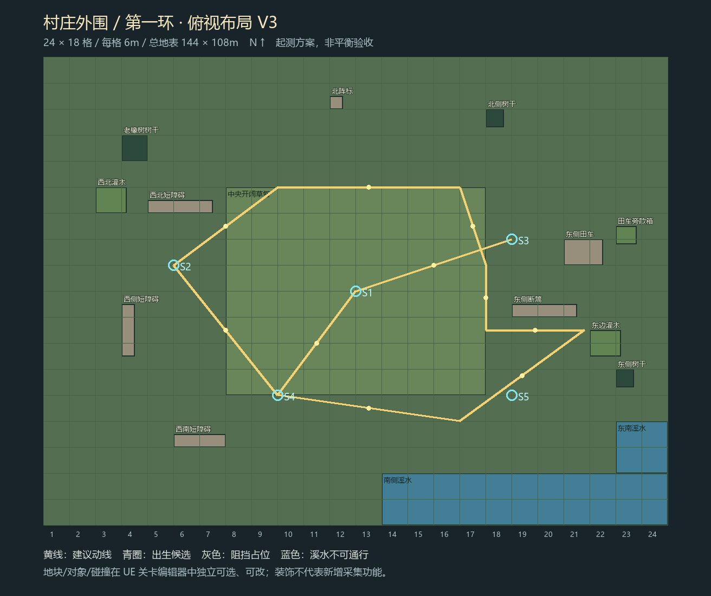
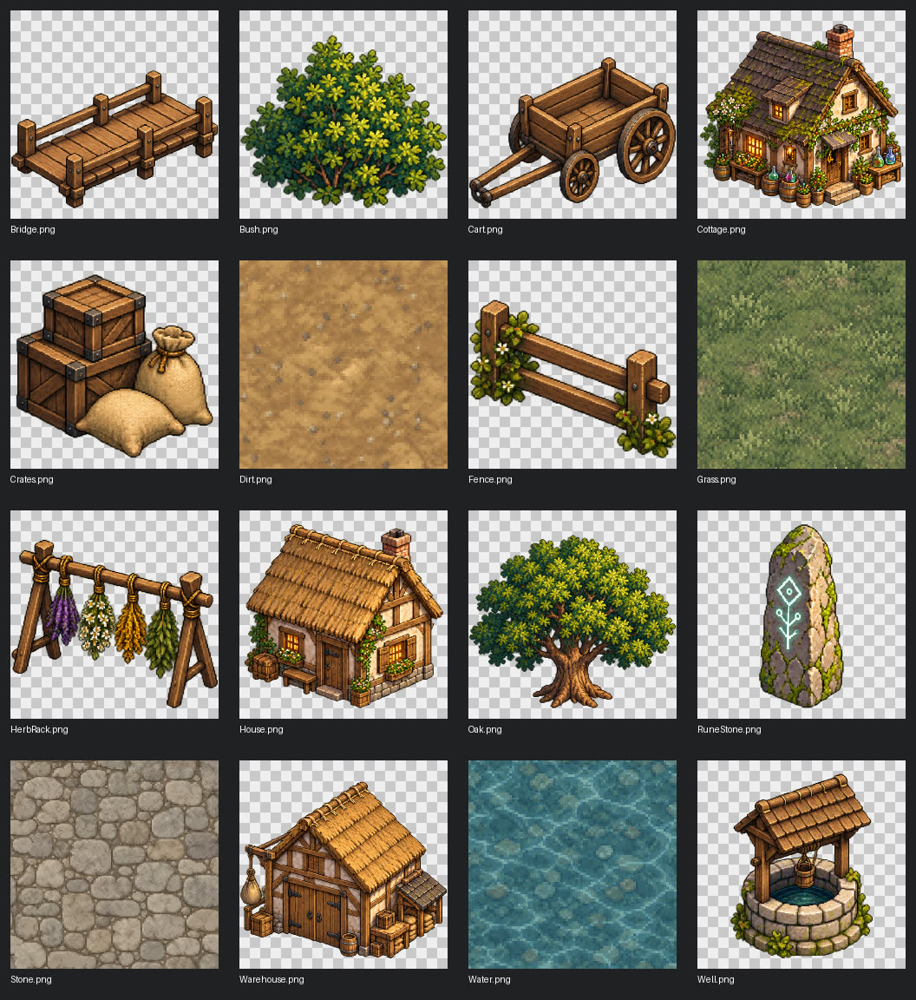

# 村庄外围（第一关）

## 现行工程：外围与Boss统一近景 · 2026-10-31

从默认`Greyford_Flow`村庄出发进入外围，使用七层乡野参考图画片和13个配准语义区域，角色/现有怪物实际移动、寻路与碰撞；在合法可达候选中随机出生。相机俯角60°，16:9近景基准宽2400cm，原生移轴跟随与动态FOV保持各深度画片注册，不锁定全图或沿用旧固定镜头空气墙。女主与村庄使用同一莉莉塔素材（工程名RoseMage）及近景角色尺度，画片明暗与后处理沿用最新实际版本。

300秒开放可选传送，进入Boss保留当前生命和本局技能/材料；首招冲刺/扇形弹幕已接入。Boss复用同一七层草甸、树、推车、断篱和石岸，隐藏旧大花平铺与旧外围占位，画片注册尺度为1.75；保留32×26m椭圆、10m开场间距、2秒准备和自由进入。准备与近距交战留双人取景余量，近身回共享近景。实现和自动验证见[统一近景与风格验收](../../04_工具与协作/AgentTeam/2026-10-31_统一近景与风格验收.md)；真人平衡/手感仍待验收，旧Windows包未重打。

故事依据为[现行故事总纲](../故事/冒牌炼金术士_故事总纲.md)与[第一幕分场蓝图](../故事/第一幕分场大纲.md)。采药、救队长、通商路是故事推进节点，尚未逐节点接通当前Flow；现有外围/Boss场地不因此等于已实现三段剧情，当前Boss也未绑定为剧情中的国王。

## 历史UE完整流程实机 · 2026-10-30

[倒计时1](附件/UE_GreyfordScale_countdown-1.png) · [开战提示](附件/UE_GreyfordScale_countdown-0.png)。2秒结束立即启动正常战斗，炼金和技能配置暂停倒计时。该截图阶段首招随机池尚待具体招式确认；当前已接入冲刺/扇形弹幕，以文首现状和验收报告为准。以下保留原设计与历史阶段说明。

维护位置：Git 仓库中的本文。原 wolai 页面只保留 Git 链接。迁移日期：2026-10-30。已确认规则、历史提案和待验证状态沿用原文，迁移不代表工程实现或平衡验收。

## 历史俯视布局、素材清单与走位检查 · 2026-10-30

独立Outskirts_Blockout：432个可编辑地块，5处出生候选；P1 6个、P2 20个实例。田车、短篱笆已替换，补散箱；长篱笆按原轴分成短模块，保留原连续碰撞。补52张软阴影和10处边缘灌木。GreyfordCombatMode已接入现有角色、敌群、技能与闪避，并读取关卡真实阻挡，使用临时进度；候选出生点未改成正式随机出生规则。

| 检查项 | 调整前 | 调整后 | 证据边界 |
| --- | --- | --- | --- |
| 西北树旁净宽 | 4.8m | 9m | 从UE保存的碰撞占位体实际变换测量 |
| 东侧田车／断篱净宽 | 6m | 9m | 只移动两段短障碍，尺寸和其他摆放保留 |
| 原生自动走位 | 8/8段通过，39.557s | 8/8段通过，39.543s | FloatingPawnMovement原生移动；时间仅复现记录，不是性能结论 |
| 候选与路线 | 候选可达 | 调整后布局检查通过 | 未做有敌群时的正式战斗或平衡验收 |

### P2与战斗空间实测 · 2026-10-30

D3D12实机，60.016秒自动压力检查通过：主路线8/8段、含回程共13段、20次闪避、击败24个敌人、峰值36个敌人，最低/结束生命93/120。复用现有移动、追击、自动技能与伤害，未提高HP或降低伤害；开始时在西北起点安排普通敌人以复现压力。代理还操作R重开、空格闪避和Tab炼金界面。此结果证明该场景下可通行与战斗运行，不是代表性真人平衡验收。

### 共享场景素材库 · 按优先级

| 优先级 | 共享素材 | 规格 | 应用与状态 |
| --- | --- | --- | --- |
| P0 | Grass 草地 | 512×512 不透明 | 两图地块；拼接自动检查pass |
| P0 | Dirt 泥路 | 512×512 不透明 | 村庄道路；拼接待美术复查 |
| P0 | Stone 石路 | 512×512 不透明 | 村庄广场；拼接待美术复查 |
| P0 | Water 溪水 | 512×512 不透明 | 溪水地块；碰撞独立，拼接待复查 |
| P1 | Cottage 炼金小屋 | 512×512 透明 | 已放入村庄 |
| P1 | House 住宅 | 512×512 透明 | 已放入村庄 |
| P1 | Warehouse 粮仓 | 512×512 透明 | 已放入村庄 |
| P1 | Oak 橡树 | 512×512 透明 | 草原3处；村庄2处，独立树干碰撞 |
| P1 | Bush 灌木 | 512×512 透明 | 两图各2处，装饰无碰撞 |
| P1 | RuneStone 阵石 | 512×512 透明 | 草原1处，村庄2处 |
| P2 | Well 水井 | 512×512 透明 | 已替换村庄水井外观；独立阻挡保留 |
| P2 | Cart 田车 | 512×512 透明 | 已替换草原田车外观；独立阻挡保留 |
| P2 | Fence 短篱笆 | 512×512 透明 | 已替换草原短篱笆；按原碰撞轴分段摆放 |
| P2 | Bridge 木桥 | 512×512 透明 | 已替换村庄木桥外观；桥面可通行 |
| P2 | HerbRack 晾药架 | 512×512 透明 | 已摆放小屋晾药架；装饰无碰撞 |
| P2 | Crates 箱袋 | 512×512 透明 | 已摆放粮仓/田车旁箱袋；装饰无碰撞 |

本轮草原已接入现有正式战斗模拟，角色半径45cm、移速5m/s、闪避2.8m；两处净宽9m。Research地图及正式存档不变。自动压力检查与代理键盘操作记录单列，不能当作真人战斗平衡验收。地表混合过渡和软阴影已加入；源纹理重复接缝仍需美术复查。

---

# 《冒牌炼金术士》场景档案

## 村庄外围

### 一、基础信息

- **区域名称：** 村庄外围

- **区域编号：** 1环

- **区域类型：** 战斗关卡

- **地理位置：** 格雷弗德边境村庄外围

- **主要地貌：** 开阔草原，夹杂少量树林

- **环境特点：** 地势相对平缓，植被茂盛，分布着草地、灌木与零散树木。

- **主要用途：** 莉莉塔收集炼金材料、遭遇魔物并进行战斗的主要区域。

### 二、区域特点

村庄外围拥有多种自然地貌，是格雷弗德周边广阔区域的一部分。第一环以草原为主，仅分布少量树林，为玩家提供开阔的战斗空间，同时保留一定的环境变化。

现行原型从村庄出发后，在外围合法、可达的候选中随机选择出生点；雾界和传送保留为关卡入口与边界表达。它们的剧情来历尚待与第一幕蓝图衔接；现行故事中的格蕾丝是不会魔法的草药医者。

随机出生使每局进入位置具有变化；当前地图与碰撞布局保持，不在每局随机重排地形。

### 三、游戏设计定位

- **地图主题：** 草原为主、少量树林点缀。

- **地形设计：** 以开阔区域为主，树林作为局部环境变化。

- **进入机制：** 现行Flow从村庄出发，随机选择外围合法可达出生点；雾界、传送的剧情解释待衔接。

- **核心玩法：** 战斗、收集普通炼金材料、获取经验与应对逐渐增强的魔物。

- **剧情关联：** 第一幕蓝图中，莉莉塔因药屋缺少草药而出村，发现熟悉的路上出现魔物；现行外围是战斗取材原型，尚未接入对应战前/战后绘本和归村AVG。

### 2026-10-30 UE独立Boss流程实现记录

- 从村庄雾门进入外围时选择随机可行走且可达的位置。累计300秒有效战斗时间后开放可选传送阵；传送阵检查整体避障和路径可达性，右侧箭头导航，站入阵内按F后再次确认，不强制传送。
- 传送时保留生命、技能与冷却；只回收已经生成的地面材料，每种容量10个。当前不自动回收金币及精英宝箱；不把活怪视为掉落收益。
- 独立Boss场地使用近椭圆32×26米可行走区、中央净空与边缘装饰。玩家从南侧、Boss从北侧进入，暂用10米间距起测。战斗结束前不能返回外围或村庄；炼金和换技能界面继续暂停战斗。
- 击杀Boss或角色死亡后走结算回村流程；结算防重复入账。Boss美术及攻击循环复用现有原型；尚未定稿的首招候选、随机池和具体招式参数没有据此宣称完成。
- 前300秒敌群密度保持原值。之后数量和刷新频率暂按每30秒增加20%起测，沿用300总量上限，不新增生命或伤害增幅。上述加压参数、10米间距仍需真人反馈，不是已确认数值定稿。
- 实现与证据详见 `../场景设计/2026-10-30_Greyford/flow-integration-verification.json`。自动状态检查采用加速时间与测试伤害，不代表真人存活5分钟、正常击杀Boss、平衡或性能验收；尚未Git提交/推送。

独立Boss准备期补充（2026-10-30实现）：入场渲染更新后开始2秒准备，玩家可移动，Boss原地等待，双方不攻击；炼金、结果和技能配置暂停准备计时。中上方2→1→开战数字细环按角色屏幕包围盒避让，2秒结束即进入正常战斗，不等待文字退场。按已确认的10米中心距起测；此前“暂用10米”不是未确认规格。加压阶梯仍待数值确认，10米是已确认的首轮测试规格，均需真人体验后验证平衡。

### 2026-10-30 人物、物件与地表比例调整

用户反馈人物相对新场景、物件和地块显得过小，并选择先查看纹理与物件调整后的效果，暂不收紧道路、广场和战斗空间。

以现有220cm角色图卡及约230cm的小屋门高为视觉标尺：小屋图卡高2450→980cm，水井850→330cm，箱袋700→180cm，灌木650→130cm，木桥宽600→360cm；其他建筑、植被与道具按同一尺寸表调整。参数入口为02_Prototype/AlchemyHD2D/Tools/GreyfordScale.json，NormalizeGreyfordScale.py会同步接地位置、阴影及对应障碍碰撞，避免缩小美术后留下旧空气墙。

可见地表石块、草丛、水纹的重复距离由600→200cm；编辑器逻辑地块仍为600cm、每图432块，地图范围和路线中心点保留。村庄镜头横向视野2844→2400cm，人物画面占比约提高18.5%；48度角、草原与Boss镜头、角色碰撞半径/移速/生命/技能与前5分钟敌群参数保持。物件碰撞占地随美术贴合，并非宣称所有障碍间隙数值不变。

[比例版验证记录](../场景设计/2026-10-30_Greyford/scale-verification.json)。新包为03_Build/冒牌炼金术士_比例调整_Win64_2026-10-30.zip，旧完整流程包保留对照；尚未Git提交或推送。尺寸比例为本轮可试玩版本，仍需用户确认观感，未据此声称真人平衡或性能验收。
