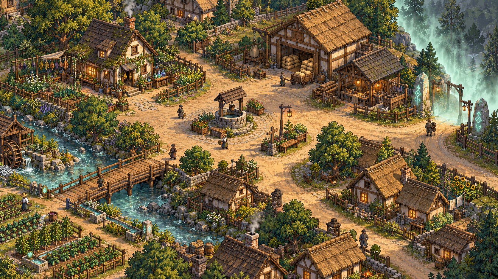
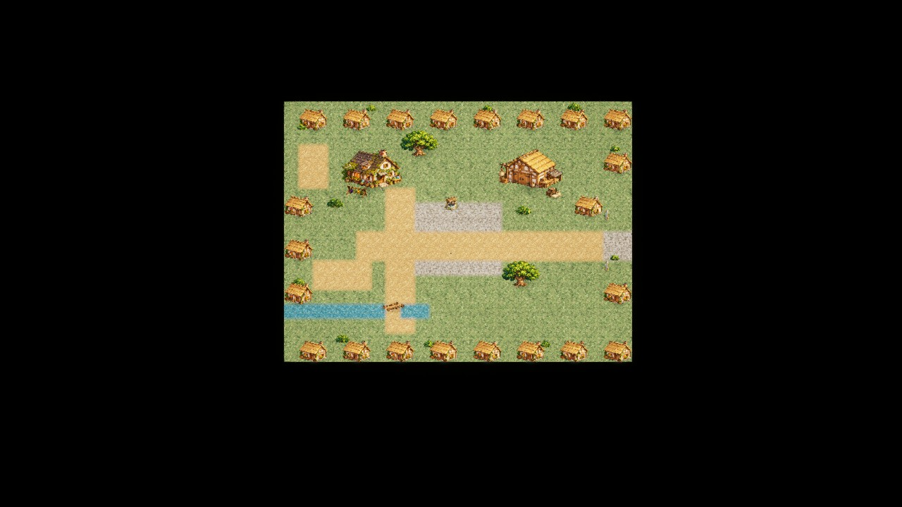
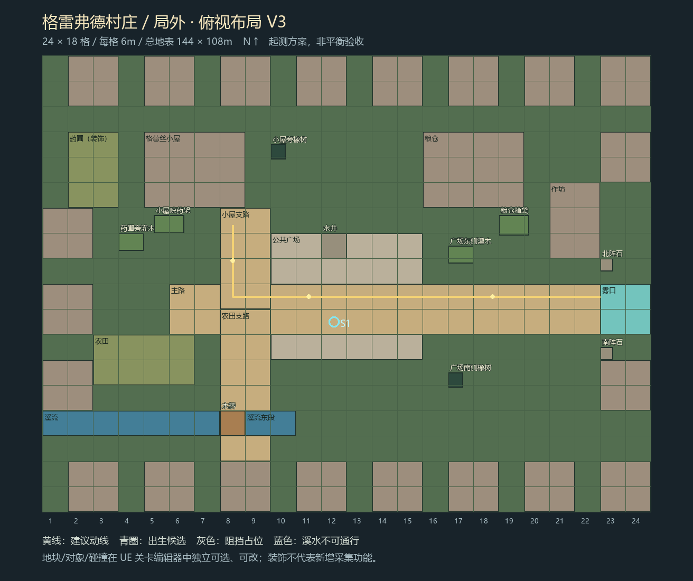

# 格雷弗德边境村庄

## 现行工程：村庄近景与流程入口 · 2026-10-31

默认地图`/Game/Greyford/Maps/Greyford_Flow`从村庄开始。实际相机俯角60°、HFOV50，16:9近景基准宽2400cm，插画采用稳定仿射注册，避免建筑被再次透视拉伸；逻辑碰撞数据保留，仅可视脚点映射并继续按脚线遮挡。现用莉莉塔（工程素材名RoseMage）及三方向走路、受击、死亡姿态；原图8名居民及对应脚点阻挡已移除。明暗与后处理沿用最新实际版本，保留原图建筑、道路和农田位置。

证据与取景范围见[统一近景与风格验收](../../04_工具与协作/AgentTeam/2026-10-31_统一近景与风格验收.md)；场景走动/碰撞/进战斗回村专项见`02_Prototype/AlchemyHD2D/Evidence/VillagePresentation_20261031/`。旧Windows包未重打，以下旧图和打包结果为各阶段历史。

剧情依据为[现行故事总纲](../故事/冒牌炼金术士_故事总纲.md)与[第一幕分场蓝图](../故事/第一幕分场大纲.md)，尚未逐节点接通试玩Flow；村庄可走动与设施功能不代表NPC主线AVG已实现。原图居民移除仅是当前美术处理，故事中的村民、队长与调查官仍按蓝图承担剧情。

## 当前编辑功能：手动碰撞轮廓 · 2026-10-31

在 Unreal 关卡编辑器中直接选择 Region 的 `Outline` 组件调整顶点、增删点或输入坐标；红色为物件阻挡，绿色为通行范围。支持撤销、保存关卡和导出回源数据。现有 13 个通行区、33 个阻挡区已迁移，默认重建美术会保留手调碰撞。

入口：工程 `02_Prototype/AlchemyHD2D/Tools/编辑村庄碰撞.cmd`；[操作说明](../../02_Prototype/AlchemyHD2D/Docs/Greyford_碰撞编辑器.md)。编辑保存后打开 `Greyford_Flow` 试玩，新修改需重新打包才会进入独立 EXE。此功能调整碰撞占地，美术遮挡仍使用当前分层。

## 历史打包版：碰撞与遮挡全图复查 · 2026-10-30

修正桥栏切腿、粮仓空地遮头、前景树冠漏遮挡，并补齐箱子、推车、围栏、灯座等占地碰撞。该版村庄为 37 个遮挡层、13 个通行区和 33 个阻挡区；脚底碰撞半径 30cm，人物可见高度、构图和跟随镜头保持。

最终 Windows 包扫描 24,662 个位置，27,168 次生产移动探测无穿越阻挡；111 个指定位置符合预期，55 个目标从出生点实际走通，所有可站立采样点连通。宽屏和 4:3 完整流程各 42 项检查及 Research 冒烟通过。这是自动实机抽样和截图复查，不等于每个连续坐标均已人工试玩。

[修正前后对照](附件/UE_GreyfordSpatial_compare.jpg) · [全图覆盖图](附件/UE_GreyfordSpatial_coverage.jpg) · [完整复查记录](../../02_Prototype/AlchemyHD2D/Docs/Greyford_碰撞层级复查.md)

该历史版试玩包：`03_Build/冒牌炼金术士_村庄碰撞修正版_Win64_2026-10-30.zip`，解压后运行“启动完整试玩.cmd”。原图和上版动态试玩保留，草原敌群密度未修改。

## 上一版：去居民、动态环境与放大跟随 · 2026-10-30

用户澄清：只去掉原图里的居民，保留红发主角测试镜头跟随。建筑、道路、桥梁和农田保持已确认原图的位置与比例。

- 原图 8 名居民及其脚点阻挡已移除。无人补图由原生 ChatGPT imagegen 生成，只用于小范围替换；原始图片仍保留。
- 镜头保持 48° 正交方向，默认放大 2 倍、视野宽约 28.94 米，随主角平滑移动并限制在图内。人物与物件同时放大，物理比例不变。
- 左侧水车原位持续转动；溪水只在水域内流动；小屋与前景房屋的两处烟囱持续升烟。树木、灯光及其他装饰仍为静态。
- 关卡编辑器中保留 24 个遮挡层、9 个通行区、4 个阻挡区，并增加 3 个可独立选择的动态环境层。

[完整构图检查](附件/UE_GreyfordAmbient_overview.png) · [过桥遮挡](附件/UE_GreyfordAmbient_bridge.png) · [北侧树篱遮挡](附件/UE_GreyfordAmbient_hedge.png) · [4:3 窗口](附件/UE_GreyfordAmbient_4x3.png)

打包版在 1280×720、1024×768 与全图模式分别通过 42 项检查。5 个移动目标走通，625 帧镜头均处于地图边界内；水车、溪流、两处烟囱的帧间变化均已确认。Research 冒烟通过。它们不代表人工战斗平衡验收。

试玩：`03_Build/冒牌炼金术士_动态村庄_Win64_2026-10-30.zip`；视频：`03_Build/格雷弗德_动态村庄实机_2026-10-30.mp4`，31.25 秒、1280×720、H.264、20fps，完整解码通过。上一版试玩包保留。

本轮证据：`02_Prototype/AlchemyHD2D/Evidence/Greyford/Ambient/verification.json`；制作说明：`02_Prototype/AlchemyHD2D/Docs/Greyford_原图分层说明.md`。

## 上一版记录：原图分层可玩村庄 · 2026-10-30

用户明确要求按指定插画 1:1 还原，并确认采用“原图分层做可玩 2.5D”。本版固定原图构图，以原图纹理、分层深度、通行与碰撞区实现，不沿用旧版规则排列房屋的构图。

[水井后方遮挡](附件/UE_GreyfordReference_well-behind.png) · [水井前方](附件/UE_GreyfordReference_well-front.png) · [4:3 窗口完整构图与操作提示](附件/UE_GreyfordReference_4x3.png) · [本轮确认原图](附件/GreyfordReference_approved.png)

人物按图中成年人约 52 像素高、180 厘米标定；当前主角首个正面帧可见高度约 180.25 厘米，在 1672×941 画面中约 52.07 像素。场景画面宽约 57.88 米。窗口比例变化时保留完整构图，不拉伸人物或场景。

本版包含 31 个局部遮挡层、9 个通行区、12 个阻挡区。斜桥有独立桥面、两端连接和前后栏杆层；水井屋顶、支柱、井台、吊桶分别处理遮挡。小屋门前强化、作坊图鉴和雾门出发继续使用现有交互与完整流程。

原图文件字节保持不变。实机使用原图坐标投影，构图位置对齐；渲染采样与颜色转换仍造成少量像素差异，不能表述为导出 PNG 与源图逐字节相等。图内原居民、溪水、水车、烟雾和灯光仍为静态预渲染内容；可控主角具备原有移动与动画。

验证：1672×941、1024×768 两种实际截图尺寸及纯场景检查各 42 项流程检查通过，其中 16 项为关键位置可达；使用实际 Move 执行路径，河流/建筑阻挡与桥面通行通过。村庄→草原→5分钟边界触发独立Boss→结算回村通过；Research 冒烟通过。边界时间加速测试不代表人工战斗平衡验收。

完整试玩包：`03_Build/冒牌炼金术士_原图分层版_Win64_2026-10-30.zip`，完整解压后运行“启动完整试玩.cmd”。UE 根关卡 `/Game/Greyford/Maps/Greyford_Flow`，村庄子关卡 `/Game/Greyford/Maps/Village_Reference`。说明与验证：`02_Prototype/AlchemyHD2D/Docs/Greyford_原图分层说明.md`、`Evidence/Greyford/Reference/verification.json`。

图层用于固定构图中的遮挡，底图包含完整建筑。若要移动建筑美术，仍须同步重绘底图；它不是可自由转动视角和重排建筑的三维模型集合。

以下内容为历史道具补齐版、旧布局与原设计记录，不代表当前村庄画面。

## 历史参考图差异与补齐 · 2026-10-30

先前工程主要完成了可走通的布局及 P1/P2 首批替换，概念图包含的种植、作坊、溪岸和生活组团没有全部实现；此前 V3 示意图也没有随比例与道路调整同步更新。不能把阶段性替换写成概念图完整还原。

| 原示意图内容 | 此轮实际状态 | 仍有的差距 |
| --- | --- | --- |
| 小屋、粮仓及住宅围合 | 重新布置 24 栋建筑，另移动 2 棵原有橡树；尺寸沿用已确认比例 | 住宅仍重复同一外观，未做逐栋变体 |
| 作坊 | 独立 Workshop 美术替换住宅外观 | 室内与生产交互未接入 |
| 药圃与菜田 | 9 组药畦、18 组菜畦、围栏及分区土壤 | 静态装饰，不代表采集/生长玩法 |
| 广场生活内容 | 2 长椅、4 花盆、4 街灯、6 木桶、4 箱袋及田车 | NPC 日常活动、设施最终美术尚缺 |
| 溪岸、水车与木桥 | 18 组岸石、静态水车、桥面木纹；既有独立桥面/栏杆保留 | 溪岸仍规则，水车未做旋转动画；桥材质需继续美术调整 |
| 村口雾门 | 独立雾门图替代重叠的通用传送图，入口坐标与交互同步 | 未实现概念图的全部雾效与灯光 |
| 树木、花木与层次 | 新增 6 棵橡树、11 组灌木，连同其余道具共 120 个实例 | 尚未完成概念图同等密度与自然分布 |

本轮 12 种新图均由原生 GPT imagegen 生成并导入 Unreal；放置对象、碰撞、地表标记保存在 Village_Blockout，可在关卡编辑器中继续修改。未改动草原地图、Boss 地图或草原地表材质。

验证：Windows 包在 1280×720、1024×768 下均通过 38 项流程检查，其中 14 项为村庄关键位置通路；原 Research 冒烟通过。包含进出草原、加速到 5 分钟边界、独立 Boss、结算返回。自动检查不等于人工平衡验收。

当前试玩包：`03_Build/冒牌炼金术士_村庄补齐版_Win64_2026-10-30.zip`。完整解压后运行“启动完整试玩.cmd”。资产、摆放与检查记录：`02_Prototype/AlchemyHD2D/Evidence/Greyford/VillageLife/`；重建入口 `Tools/DressGreyfordVillageLife.py`，俯视图入口 `Tools/DrawGreyfordVillageLife.py`。

以下为原设计和历史阶段记录，其中旧版布局与旧版完成状态不代表本轮现状。

## 历史UE完整流程实机 · 2026-10-30

[桥后层级实机](附件/UE_GreyfordVillageCompact_04-bridge-behind.png)。完整解压试玩包后运行“启动完整试玩.cmd”。以下保留原场景设计与历史阶段说明。

维护位置：Git 仓库中的本文。原 wolai 页面只保留 Git 链接。迁移日期：2026-10-30。已确认规则、历史提案和待验证状态沿用原文，迁移不代表工程实现或平衡验收。

## 历史俯视布局与素材清单 · 2026-10-30

Unreal已保存独立Village_Blockout：432个可编辑地块，P1 30个、P2 4个实例。水井和木桥已替换；小屋旁补晾药架，粮仓旁补箱袋。补68张可编辑软阴影、10处边缘灌木，地表采用草/泥/石/水混合过渡。格蕾丝本人缺席，药圃仅装饰，不新增固定采集玩法。

| 优先级 | 素材 | 规格 | 当前状态 |
| --- | --- | --- | --- |
| P0 | Grass 草地 | 512×512／不透明 | 已导入地块材质；拼接自动检查 pass |
| P0 | Dirt 泥路 | 512×512／不透明 | 已铺设；拼接仍需美术复查 |
| P0 | Stone 石路 | 512×512／不透明 | 已铺设；拼接仍需美术复查 |
| P0 | Water 溪水 | 512×512／不透明 | 已导入并分配；溪岸阻挡独立，拼接待复查 |
| P1 | Cottage 炼金小屋 | 512×512／透明 | 已替换村庄对应占位外观 |
| P1 | House 住宅 | 512×512／透明 | 已替换村庄住宅及作坊外观 |
| P1 | Warehouse 粮仓 | 512×512／透明 | 已替换村庄粮仓外观 |
| P1 | Oak 橡树 | 512×512／透明 | 已放入村庄与草原；树干碰撞独立 |
| P1 | Bush 灌木 | 512×512／透明 | 已放入两图；装饰无碰撞 |
| P1 | RuneStone 阵石 | 512×512／透明 | 已替换村口与草原阵标外观 |
| P2 | Well 水井 | 512×512／透明 | 已替换村庄水井外观；独立阻挡保留 |
| P2 | Cart 田车 | 512×512／透明 | 已替换草原田车外观；独立阻挡保留 |
| P2 | Fence 短篱笆 | 512×512／透明 | 已替换草原短篱笆；按原碰撞轴分段摆放 |
| P2 | Bridge 木桥 | 512×512／透明 | 已替换村庄木桥外观；桥面可通行 |
| P2 | HerbRack 晾药架 | 512×512／透明 | 已摆放小屋晾药架；装饰无碰撞 |
| P2 | Crates 箱袋 | 512×512／透明 | 已摆放粮仓/田车旁箱袋；装饰无碰撞 |

资源位于Content/Greyford；原始图与提示词位于ArtSource/Greyford20261030。新增两张24×18地表数据遮罩与混合材质，地块仍可编辑；改画地表后运行DressGreyfordP2.py刷新遮罩。阴影为独立风格化软阴影卡片。原图平铺接缝仍需美术复查，本轮未重新打包Windows试玩版。

---

# 格雷弗德边境村庄（Greyford）

**村庄类型：** 西方奇幻世界中的边境村庄

### 一、基础信息

- **地理位置：** 位于国家边境地区，远离主要城市。

- **区域类型：** 局外安全区

- **村庄规模：** 二十多户人家，整体面积不大。

- **自然环境：** 周边分布着树林、农田、草地与溪流，适合农业生产和草药采集。

- **资源状况：** 日常生活资源充足，基本能够自给自足。

- **主要产业：** 农业、畜牧、手工业及少量对外贸易。

### 二、村庄特点

村庄以农作、手艺和少量贸易维生，日常基本能够自给自足。格蕾丝凭草药经验行医，药屋为村民提供照护和药物；灾情与道路中断对供药的影响见第一幕故事蓝图。

村庄规模虽小，却拥有住宅、农田、仓库及公共活动区域。村民彼此熟悉，整体氛围宁静、友善，生活节奏缓慢。

### 三、重要人物

- **格蕾丝：** 42岁的草药医者，不会魔法，长期居住于此；莉莉塔的养母。

- **莉莉塔：** 14岁，被格蕾丝收养后在这里生活，随养母认识草药；第一幕蓝图中在首次归村后通过拉结尔学习炼金。

### 四、剧情背景

现行故事中，格蕾丝发现搜捕正在追查自己的买药者，又听闻西边行医旧识所在的村庄出事，误以为独自离开能使莉莉塔免受牵连，便不告而别。魔物源于药剂中的魔法病毒及其传播，猎巫造成的长期恐惧会加重异变；具体前史与角色所知范围以故事总纲为准。

第一幕蓝图由近郊采药、报告魔物、唤醒拉结尔与学习合成，逐步推进到救回队长和清通商路。当前Flow仍提供外围局内教学、随机出生、雾界和独立Boss战；这些原型机制尚未与剧情逐节点接通，雾阵来历待衔接，不据其存在确认格蕾丝施法或预制炼金阵。

### 2026-10-30 UE完整流程实现记录

- 入口为 `/Game/Greyford/Maps/Greyford_Flow`，使用持久关卡串联村庄、外围与独立Boss场景。村庄可直接控制现有炼金术士角色；靠近炼金台、图鉴台、村口雾门按F交互。沿用现有角色原型，不代表莉莉塔最终角色美术已完成。
- 木桥取消整张直立桥图的运行时显示，改为水平桥面、南北坡道及独立栏杆/立柱。角色按桥面高度行走，设施仍在UE关卡编辑器中逐项编辑；原桥图与首次修改前地图备份保留。
- 完整流程使用独立存档槽 `GreyfordDemo_v1`；胜利和死亡结算后都可回村再次出发。设施可达性、桥前/桥上/桥后的画面证据和打包验证见 `../场景设计/2026-10-30_Greyford/flow-integration-verification.json`。
- 本地试玩包为 `03_Build/冒牌炼金术士_完整流程_Win64_2026-10-30.zip`，完整解压后运行“启动完整试玩.cmd”。本次实现及素材修改尚未提交或推送Git。

### 2026-10-30 人物、物件与地表比例调整

用户反馈人物相对新场景、物件和地块显得过小，并选择先查看纹理与物件调整后的效果，暂不收紧道路、广场和战斗空间。

以现有220cm角色图卡及约230cm的小屋门高为视觉标尺：小屋图卡高2450→980cm，水井850→330cm，箱袋700→180cm，灌木650→130cm，木桥宽600→360cm；其他建筑、植被与道具按同一尺寸表调整。参数入口为02_Prototype/AlchemyHD2D/Tools/GreyfordScale.json，NormalizeGreyfordScale.py会同步接地位置、阴影及对应障碍碰撞，避免缩小美术后留下旧空气墙。

可见地表石块、草丛、水纹的重复距离由600→200cm；编辑器逻辑地块仍为600cm、每图432块，地图范围和路线中心点保留。村庄镜头横向视野2844→2400cm，人物画面占比约提高18.5%；48度角、草原与Boss镜头、角色碰撞半径/移速/生命/技能与前5分钟敌群参数保持。物件碰撞占地随美术贴合，并非宣称所有障碍间隙数值不变。

[比例版验证记录](../场景设计/2026-10-30_Greyford/scale-verification.json)。新包为03_Build/冒牌炼金术士_比例调整_Win64_2026-10-30.zip，旧完整流程包保留对照；尚未Git提交或推送。尺寸比例为本轮可试玩版本，仍需用户确认观感，未据此声称真人平衡或性能验收。

### 2026-10-30 村庄道路与广场收紧（替代上一轮暂不收紧的选择）

用户认可物件比例，明确要求村庄道路和广场进一步收紧。保留已认可的人物/建筑/植被/道具尺寸、2m地表纹理、24m村庄视野及世界边界；本次只调整村庄铺装与功能设施位置，草地仍可行走，不新增道路外隐形墙。

- 主路宽12→4m，支路3m，补齐小屋门前、粮仓、农田与桥头连接；桥宽维持3.6m。
- 广场36×30→18×12m，强化台/图鉴台聚拢至广场两侧，水井移到北侧；出生点调整到广场内，重新检查设施可达性。
- 村庄地表遮罩提升到0.5m采样，仍保留432个6m编辑逻辑块，避免为了3m道路新增大量地块Actor。已有铺装标记在UE关卡编辑器Greyford/VillagePaving里移动/缩放，运行Tools/CompactGreyfordVillage.py烘焙；设施点在Greyford/VillageFacilities里编辑，运行时读取。GreyfordVillageLayout.json是初建默认值，已有标记位置/尺寸优先。
- 重跑BuildGreyfordFlow.py或P2地表替换后会恢复紧凑村庄铺装。草原地图、Boss地图及草原地表材质在本次前后SHA256一致，角色和战斗参数保持。
- [村庄紧凑版验证](../场景设计/2026-10-30_Greyford/village-compact-verification.json)。新包03_Build/冒牌炼金术士_村庄紧凑版_Win64_2026-10-30.zip；旧比例版保留。自动检查通过不等于真人动线、观感或性能验收。本次未Git提交/推送。
