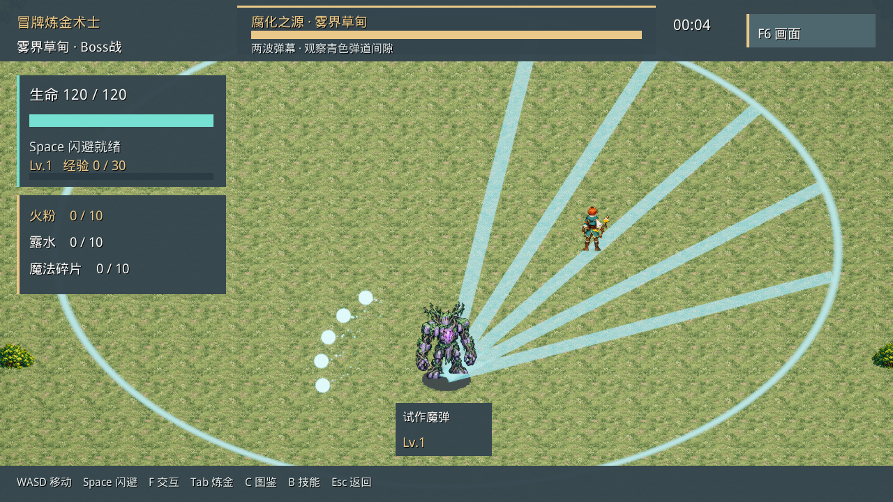
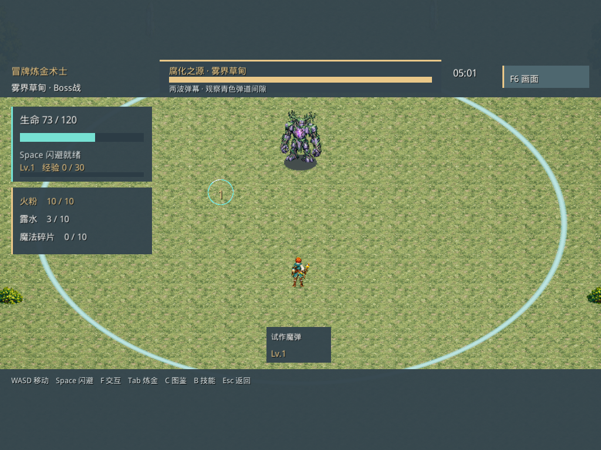

# 最新源码 Windows 试玩版 · 2026-10-31

[下载便携ZIP](../../../03_Build/冒牌炼金术士_最新试玩_Win64_2026-10-31.zip) · [SHA256校验文件](../../../03_Build/冒牌炼金术士_最新试玩_Win64_2026-10-31.zip.sha256) · [结构化验证记录](release-verification.json)

全部解压到本地文件夹，双击“启动完整试玩.cmd”；保留完整Windows目录。无需安装UE编辑器。“直接测试Boss.cmd”使用隔离进度，供检查读招、移动与躲避；成长和结算请走完整流程。操作及测试默认值见包内运行说明与Boss规则说明。

源码基线：`2826752afbdd6f38f8f70182129dfbd9e1c6b141`。UE5.8.4，Development Win64。包含当前已保存的村庄碰撞、村庄→草原→独立Boss流程、首次范围技能小群、新Boss冲刺及两波弹幕。碰撞编辑器仍是UE编辑功能；本EXE使用此次Cook的地图数据，后续编辑不自动更新已有EXE。

## 本轮验证

- DataValidation：295个资源，0错误、0警告。Build/Cook/Stage/Archive成功，UAT exit0。
- 打包EXE的D3D12空间检查：24,662个网格点，3,396个可站立点，27,168次移动探测，0穿越失败；1个连通区，55条地标路径全部通过。详见coverage.txt和spatial检查摘录。
- 1280×720、1024×768两种比例的完整流程检查均PASS，覆盖设施可达、桥面、传送阵确认、保留生命与构筑、Boss准备期、暂停、胜败结算与回村。
- 原系统ALCHEMY_SMOKE_PASS、ALCH002_TEST_PASS；28项PLANNED_BOSS_CHECK和D3D12 Boss截图检查通过。已查看本轮村庄、第二波锁定、4:3准备倒计时截图。
- ZIP完整CRC与关键EXE/Pak容器SHA256检查；包内关键文件与实际通过上述测试的文件一致。版本信息在包内build-info.json。

可复跑命令（在项目根目录的PowerShell执行）：

```powershell
& ./02_Prototype/AlchemyHD2D/Tools/PackageGreyford.ps1 -BuildDirectory Greyford_Latest_Win64_20261031
& ./02_Prototype/AlchemyHD2D/Tools/TestGreyfordSpatial.ps1 -BuildDirectory Greyford_Latest_Win64_20261031
& ./02_Prototype/AlchemyHD2D/Tools/TestBossPlan.ps1 -BuildDirectory Greyford_Latest_Win64_20261031
& ./02_Prototype/AlchemyHD2D/Tools/TestBossPlan.ps1 -BuildDirectory Greyford_Latest_Win64_20261031 -Visual
```

完整原始日志保留在本地SSD工程Evidence；本目录发布检查摘录、覆盖统计、关键截图与JSON报告。重新运行脚本会更新本地测试输出。

自动流程使用加速计时、状态跳转及测试伤害；不代表真人存活5分钟、正常击败Boss、性能或平衡验收。Boss提示音资源已加载，测试用了nosound，未做真人听感验收。剩余弹丸淡出0.15秒等起测默认仍待确认。本次未重部署官网。





