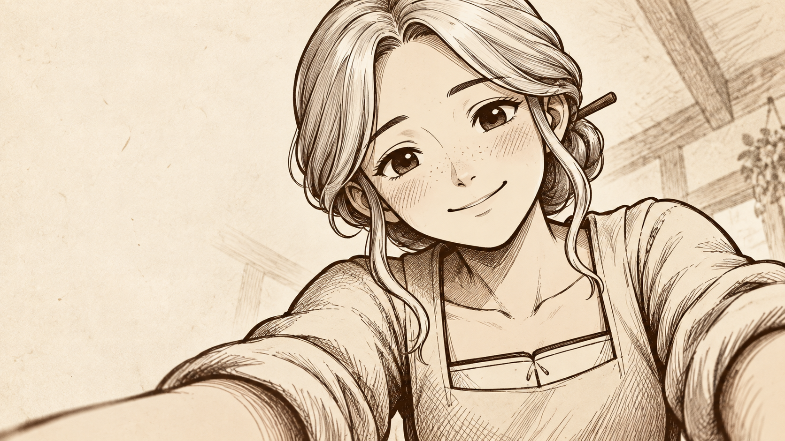
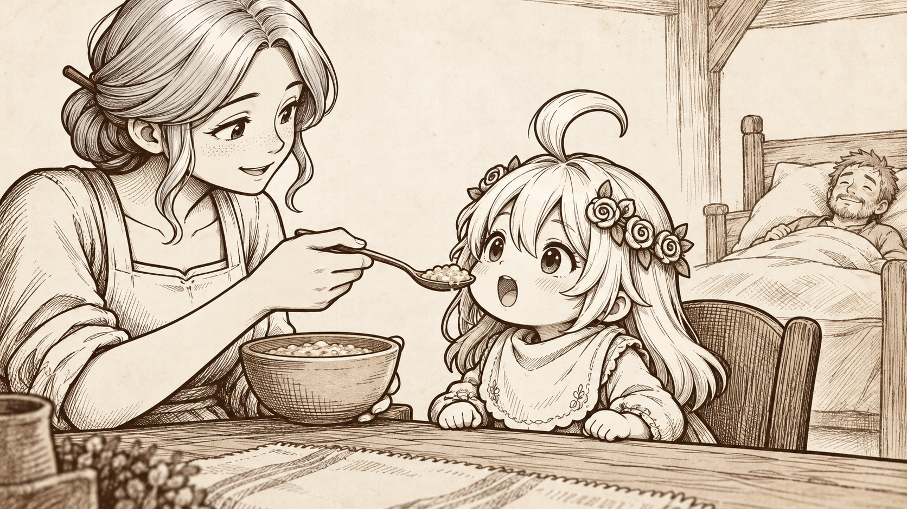
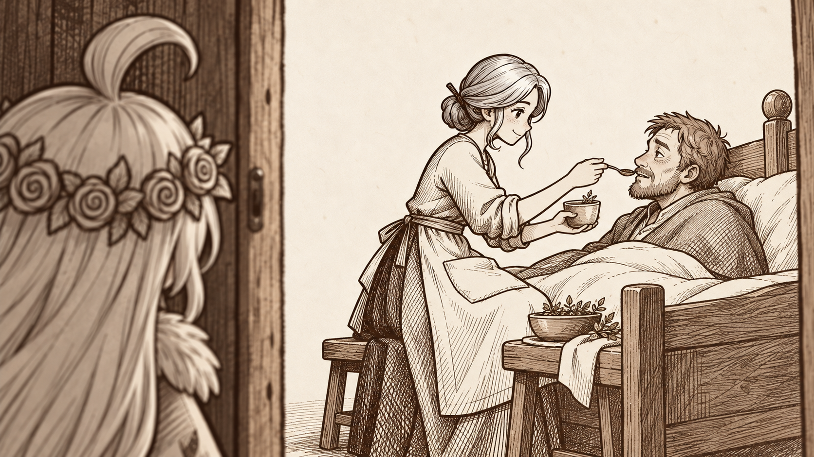
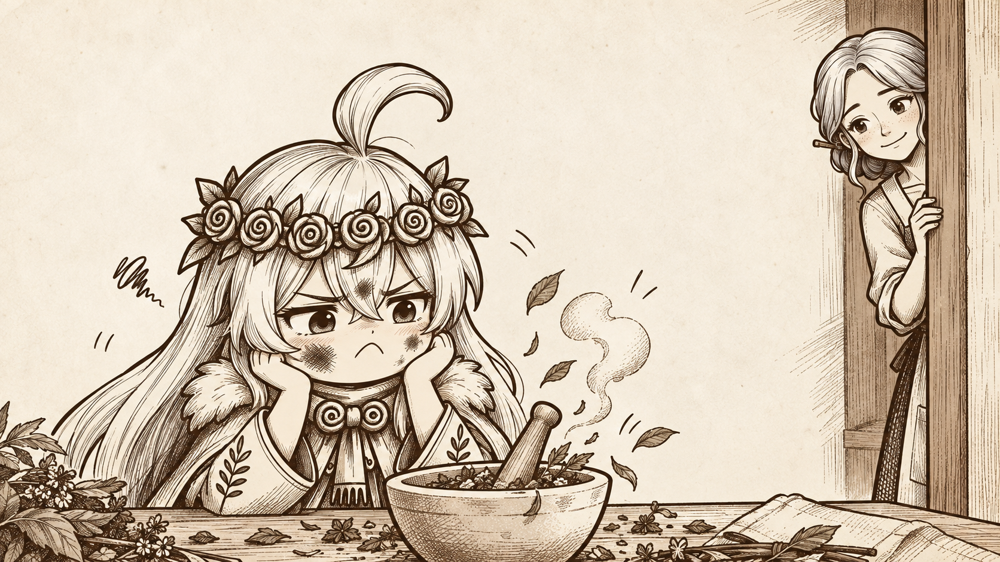
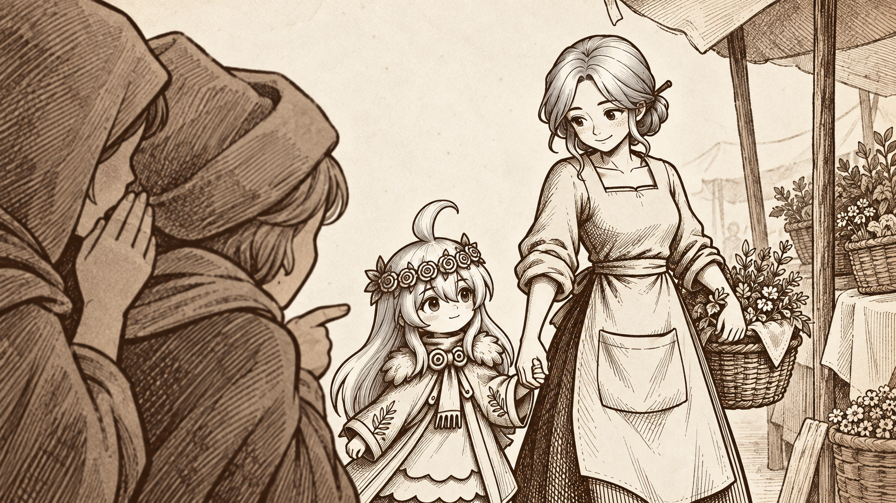
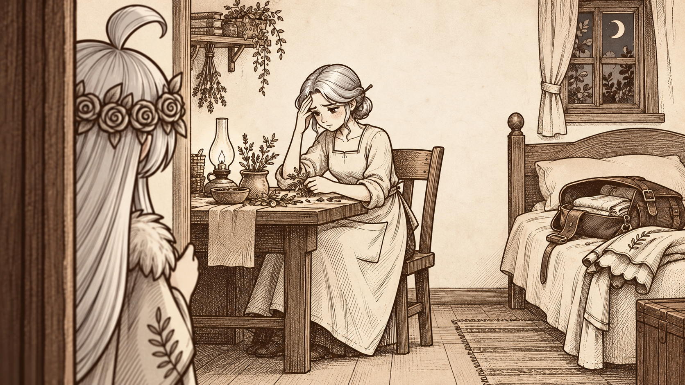
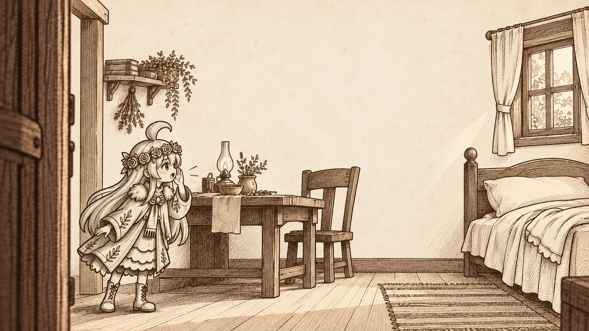

# 序章八画｜图片总览

2026-10-31首轮生图交付。使用内置image_gen，八张原画均已保存本地，尺寸1672×941，接近16:9；未烘焙字幕。这里只交付图片与演出文字，没有生成动画或配音；正式角色设计板与最终美术尚未确认，首版图片不等于引擎剧情已接入。

画面沿用[Style Bible](../Style_Bible.md)与[八画构图](../序章构图与节奏.md)，以羊皮纸和褐墨排线为主，只有第五画的药草点灰绿。图中近景与远景交替，保留母女日常、偷配药的小幽默，以及末尾的异常与缺席。

| 画面 | 旁白 | 建议停留 | 制作说明 |
| --- | --- | --- | --- |
| 01／她的笑 | 我最先记住的，是她的笑。 | 6秒 | [逐画说明](scene-01.md) |
| 02／先吃这一口 | 家里常有人等着喝药。我等着吃饭。 | 7秒 | [逐画说明](scene-02.md) |
| 03／门边的小观察者 | 原来大人有时候也要人喂。 | 7秒 | [逐画说明](scene-03.md) |
| 04／动静倒不小 | 我也试了一次。药没配好，动静倒不小。 | 8秒 | [逐画说明](scene-04.md) |
| 05／一起蹲下来 | 后来，她教我先认清锅里放的是什么。 | 7秒 | [逐画说明](scene-05.md) |
| 06／集市里的小声音 | 有些人叫她魔女。我还是叫她妈妈。 | 7秒 | [逐画说明](scene-06.md) |
| 07／那晚还没睡 | 那晚她还没睡。我以为她明天会晚一点起床。 | 8秒 | [逐画说明](scene-07.md) |
| 08／妈妈？ | 妈妈？ | 7秒 | [逐画说明](scene-08.md) |

建议总长57秒，实际阅读时间可调整。完整输入参考与实际提示词见[生图记录](../制作记录/序章八画_生图记录.json)。这是一套已完成的首版图片，后续可按审美反馈统一精修；不据八张图承诺后续视频生成零漂移。

## 01／她的笑

我最先记住的，是她的笑。

## 02／先吃这一口

家里常有人等着喝药。我等着吃饭。

## 03／门边的小观察者

原来大人有时候也要人喂。

## 04／动静倒不小

我也试了一次。药没配好，动静倒不小。

## 05／一起蹲下来

后来，她教我先认清锅里放的是什么。

## 06／集市里的小声音

有些人叫她魔女。我还是叫她妈妈。

## 07／那晚还没睡

那晚她还没睡。我以为她明天会晚一点起床。

## 08／妈妈？

妈妈？
