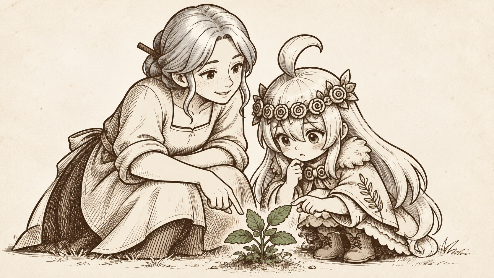

# 序章05｜一起蹲下来

状态：2026-10-31已生图，首轮交付。画面为单幅绘本，16:9近似横幅，无文字、无网格；不另拆九宫格。

## 画面与旁白

母女蹲着围看草药，屈膝、手势与脸形成聚拢构图；草药为唯一灰绿点色。

独立旁白：**后来，她教我先认清锅里放的是什么。**

## 未来演出提示

建议时间段：00:28—00:35，本画7秒；时长可随阅读调整，本轮未生成视频或配音。

以这张原画保持人物、墨线与纸面不变；只允许整幅约1.00—1.025倍缓慢推拉、翻页或淡入淡出，禁止重新绘制人物、增加表情或随机抖动排线。旁白在游戏独立文字层显示，不烘焙进图。

只保留药草的灰绿，人物与其余物件继续使用褐墨；不扩展彩色范围。

## 连续性与禁止项

固定人物身份、年龄阶段、发型、服装符号与器物。无现代开关、法术、水印、字幕、信件和额外人物；近景可裁切，不为展示全套服装改回站姿。

实际生图使用内置image_gen，完整提示词与输入参考见[八画生图记录](../制作记录/序章八画_生图记录.json)的scene 05；风格与故事依据见[Style Bible](../Style_Bible.md)和[构图方案](../序章构图与节奏.md)。
