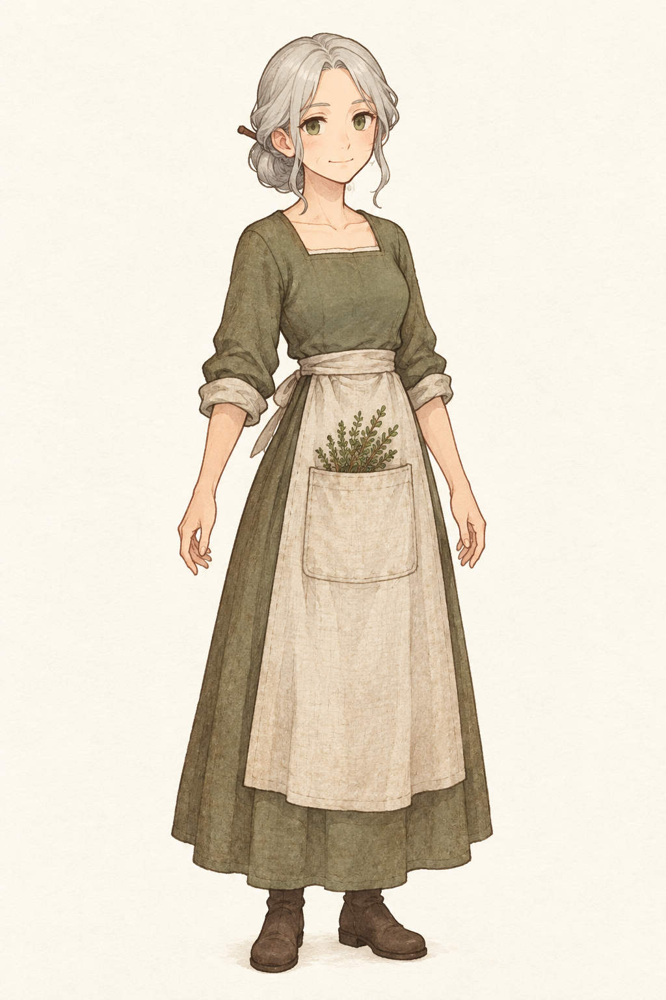
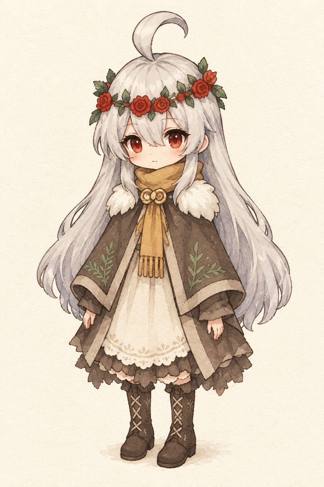

# 《冒牌炼金术士》序章绘本 Style Bible

日期：2026-10-31。工作稿；供本轮形象与关键画面制作使用，待用户审美确认后再作为正式美术基准。

故事依据：[故事总纲](../../故事/冒牌炼金术士_故事总纲.md)、[第一幕P00](../../故事/第一幕分场大纲.md)。本方案只将既有六画转化为美术和动画制作规范，不新增剧情。

## 1. 画面基调

**像翻开一本被珍惜的小家庭相册：温暖、亲近、有一点认真过头的小幽默。**

欧洲乡村西幻，木梁、灰泥、亚麻、陶碗、药草与旧木家具。棕色细墨线配不透明水粉和淡水彩，象牙纸纹；人物保留日式游戏的简化面部与清楚轮廓，背景用柔和绘本笔触。使用普通生活光源，不画法术粒子。

莉莉塔原图是**身份与服装依据**，不要求沿用像素渲染；本轮将其译成绘本。格蕾丝使用较修长的成年人体态，莉莉塔保持大头、小身体的原设计，不把养母也画成同龄小女孩。

| 色彩用途 | 建议色 | 使用方式 |
| --- | --- | --- |
| 纸与日光 | `#F3E8CF` | 全篇底色，日间保持明亮 |
| 墨线与木头 | `#584437` | 避免纯黑大块轮廓 |
| 格蕾丝衣裙、药草 | `#737455` | 安稳的灰苔绿 |
| 围裙与内裙 | `#D9C9A9` | 旧而干净的亚麻 |
| 莉莉塔披风 | `#756457` | 灰棕，不改为黑色或紫色 |
| 围巾与灯火 | `#BE914C` | 蜂蜜般的温暖，少量点亮 |
| 玫瑰与红瞳 | `#A83C36` | 莉莉塔身份强调色，避免全画面鲜红 |

以上是调色目标，不是声称生成图逐像素符合的取色数据。夜景保留暖灯与少量冷灰蓝环境光，不能突然变成恐怖片。

## 2. 角色基准

### 格蕾丝

**42岁、女、偏瘦，普通草药医生，不会魔法。** 银灰发中分、后颈低发髻、简单木发簪，两侧少量发丝；灰橄榄绿眼睛，温和而略有主见的表情。灰苔绿长裙、卷至前臂的袖口、燕麦色亚麻围裙，围裙正面一个大方口袋，放少量药草；深棕短靴。成年基准约五至六头身，保持与莉莉塔明显的年龄和身高差。

她的可爱来自认真照顾生活，不来自夸张尖鼻子、魔女帽或法杖。禁止尖耳、魔法光环、悬浮器皿、青春少女化或老妪化。

### 莉莉塔

**14岁、女、瘦小。** 用户原图的长银白发、向上弯起的一大缕呆毛、红眼、红玫瑰绿叶花环必须保留；灰棕披风上的绿色蕨叶纹、白色肩部绒毛、赭金围巾与双卷圆扣、象牙色波浪裙边、深棕系带靴构成固定服装。

童年版维持同一套可识别符号，脸更圆、四肢更短，约两至三头身；十四岁版约三头身。参考图中的玫瑰法杖不加入家务和采药画面，不能据此给格蕾丝增加魔法。睡前画面若需要换睡衣，应先另做角色基准；本轮为减少漂移，保持绘本化日常装，不另画脱衣或换装过程。

| 画面 | 莉莉塔年龄 | 格蕾丝年龄 | 处理 |
| --- | --- | --- | --- |
| P01收养 | 婴儿 | 约28岁 | 婴儿只有白发小卷、红眼和米色襁褓，不戴成人花环；格蕾丝保留脸型发型，减轻成熟纹理 |
| P02—P04 | 约6岁 | 约34岁 | 使用童年与年轻养母基准 |
| P05—P06 | 14岁 | 42岁 | 使用当下基准，P06格蕾丝不在画面中 |

这是序章作画的时间分配提案，不改变总纲中的当前年龄；多年沿用服装配色是绘本的识别约定，不意味着十四年没有换衣服。

## 3. 固定药屋

药屋是一间紧凑的乡村生活工作室。画面左侧为小格窗与餐桌，两只大小不同的陶碗；中间为木药台、陶研钵和无字药罐；右侧为床铺与木凳，木梁下挂晒干的药草。门位于右侧墙端。P01建立空间，后续室内画面将其作为环境参考；不能随意左右镜像或改成城堡、现代实验室。

餐桌、药台和床位服务于“这是同一个家”。可因构图只见其中一部分，不必每张塞满所有道具。行囊仅在P05成为背景线索，P06可以不在；不画任何告别信、便条、地图暗号或额外提示物。

## 4. 构图与文字

- 关键画面统一16:9；工作图1536×864，正式制作可在确认后再重绘或放大。横向留出约5%裁切余量，人物脸和关键道具不贴边。
- 优先一幅完整插画，不做漫画分格。母女及当画关键物位于中部可读区域；下方尽量疏朗，字幕另在展示层叠加，不让模型生成中文。
- 文字沿用P00原旁白；收养体现被接纳，笑点落在花、蜂蜜、认真长高上。外人的敌意放在边缘，母女关系仍是画面中心。
- P05焦虑与半包行囊可见但不抢眼；P06明亮、安静，结束于主动寻找，不提前表现绝望、死亡或追捕。

## 5. 稳定动画的实现

本轮采用**绘本动态分镜**：定稿插画作为不可变底图，通过整幅画1.00—1.035倍缓慢推拉、轻微平移与淡入淡出形成观看节奏。母女的脸、手、衣纹、花环不会重新生成，避免视频模型产生身份漂移。

六画建议时长依次8、8、8、8、9、9秒，总计约50秒；允许手动翻页与跳过。字幕由独立文本层排版，自动播放支持暂停，减少动画偏好的设备停用推拉。预览是节奏与气质验证，不是完成配音、音乐、分层角色动画或最终游戏演出。

后续若需要眨眼、衣摆或发丝运动，先将批准的原画拆成带遮挡补绘的独立图层，再制作小幅骨骼/网格动画；不能把整张含多人画面直接交给视频模型就视为稳定。尚未生成透明分层素材，不把普通PNG宣称为可直接驱动的角色骨架。

## 6. Scenario制作约定

本轮使用`GPT Image 2.5 Flare`，`quality=medium`，先报价后生成；角色1024×1536，场景1536×864。固定完整画风与人物描述，每画仅更改年龄阶段、地点和本画事件；角色参考使用单人基准图，原始三视图只用于建立莉莉塔基准，不能作为后续场景或视频首帧。

母女参考必须明确各自职责，禁止将红瞳、玫瑰花环转移给格蕾丝。室内场景另加同一药屋参考，只借空间与物件，不继承该参考中的婴儿或其他年龄。重复seed不保证角色一致，参考图与逐画核对才是依据。所有素材、提示词和制作记录留在本目录。

**验收**：认得出两位角色；年龄阶段正确；衣服主要符号、发髻与花环不串人；母女关系温暖；格蕾丝无施法；P05行囊半包；P06没有母亲也没有信；字幕未烘焙进原画；六画顺序与第一幕一致。生成图通过内部核对仍属于待用户确认的工作稿。
