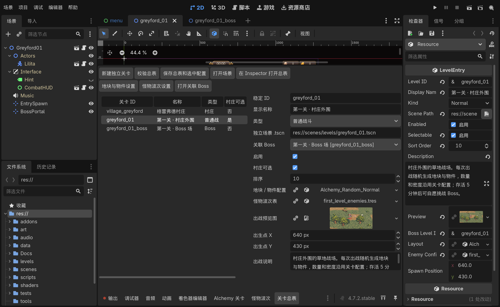
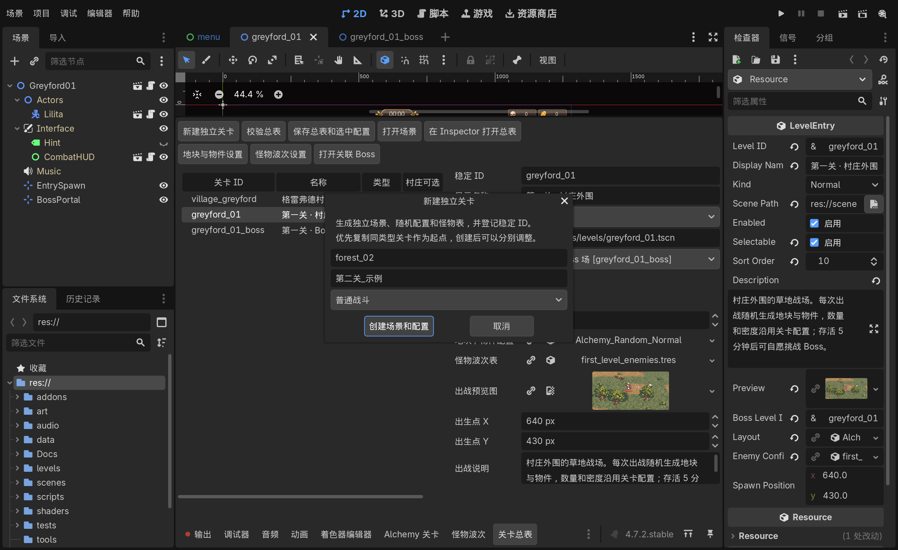
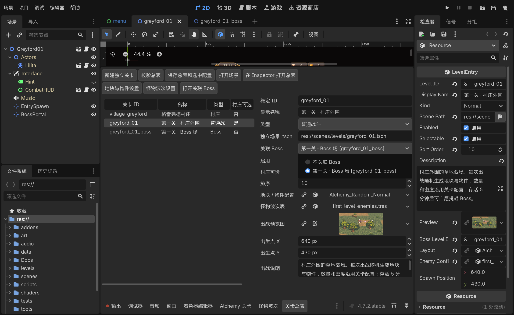
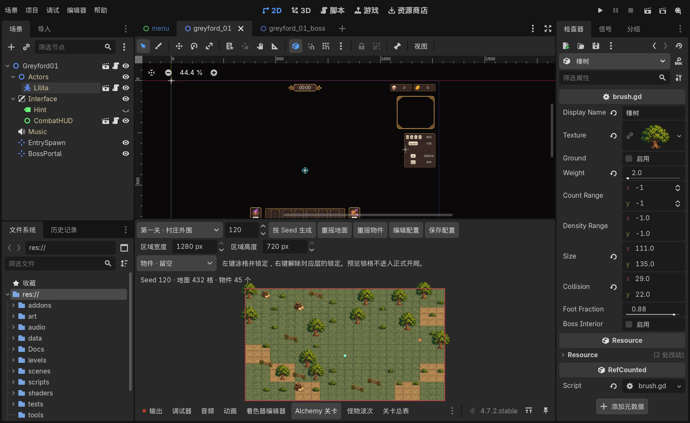
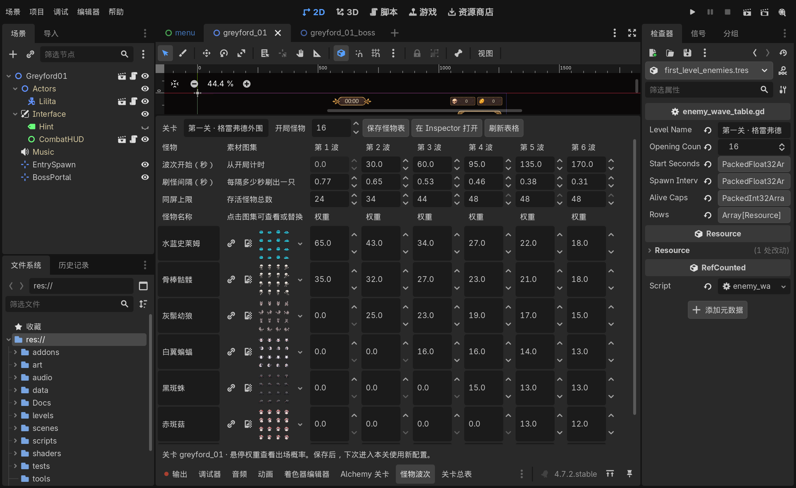
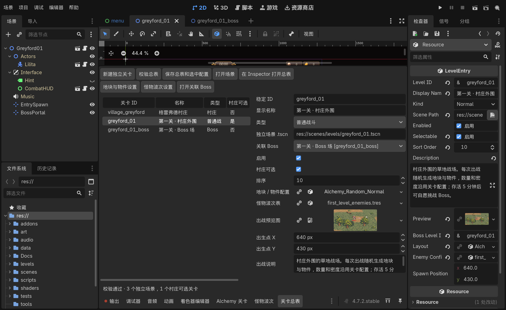
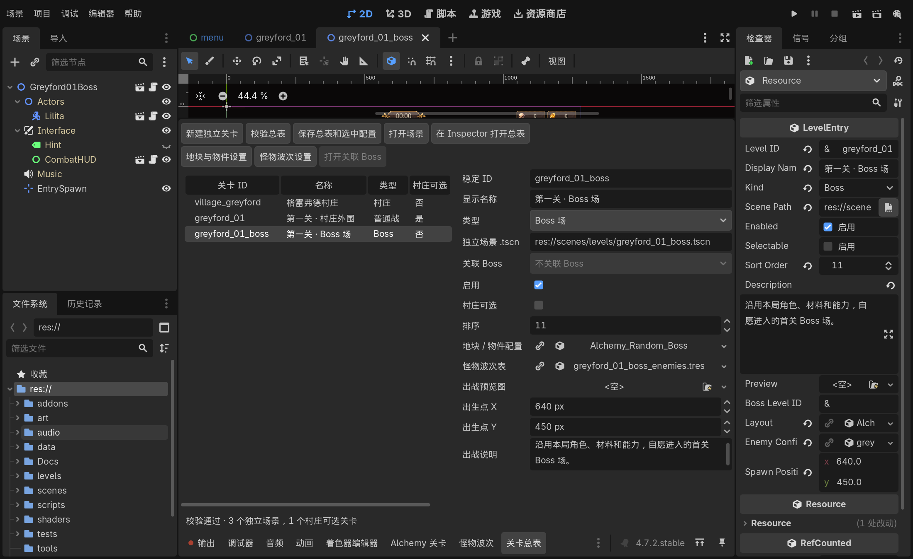

# 关卡总表与出战准备

用 Godot 4.7.2 Standard 打开本工程。本文供策划、美术配置关卡使用；编辑入口是窗口底部「关卡总表」，游玩入口是 F5 → 开始界面 → 村庄 → 右侧雾门按 F → 出战准备 → 普通战斗 → 300 秒后自愿挑战 Boss。

## 给玩家的界面

左侧选目的地，可滚动；右侧选本局唯一的炼金能力。切换关卡会保留能力选择，底部汇总目的地、能力和消耗。取消返回村庄，不扣库存。

基础炼金永久免费。其他能力必须先在工房制作；目的地完整加载、随机场地生成和保存均成功后，才消耗一份。失败留在准备页，显示原因。面板打开时角色停止移动，工房和准备页不会同时打开。

目前只登记真实存在的第一关。示意图中的关卡 02—06 是布局占位，没有作为游戏内容加入。

## 跟着编辑器截图操作

以下是当前工程在 Godot 编辑器中的实际截图（2026-11-24）。点击图片可放大。窗口较小时，先最大化编辑器，再向上拖动底栏上沿；右侧 Inspector（检查器）也可以拖动边界加宽。表格看不全时使用底部横向滚动条。

截图中的实际关卡仍是第一关。`forest_02` 只填写在新建窗口中，没有点击创建；按下面步骤操作时，换成你自己需要的 ID 和名称。

### 1. 找到总表，选中要配置的关卡

点击窗口底部「关卡总表」，在左表单击 `greyford_01`。右侧会同步显示该关的稳定 ID、独立场景、Boss 关联、随机配置和怪物表。**先确认选中行和右侧 ID 一致，再改参数。**

### 2. 新建独立关卡

点总表左上角「新建独立关卡」。窗口内从上往下分别是 **ID、显示名称、关卡类型**。例如填写 `forest_02`、`第二关_示例`、`普通战斗`。

ID 必须唯一，以小写字母开头，其后只用小写字母、数字和下划线。点「创建场景和配置」后，工具立即创建并保存独立 `.tscn`、地块物件配置和怪物表，再登记到总表；已有文件不会覆盖。素材先沿用模板，之后可分别替换。只想查看时点「取消」。

### 3. 设置出战开关，关联 Boss

普通关勾选右侧「启用」「村庄可选」。要配套 Boss，先再次点「新建独立关卡」，使用另一个 ID（例如 `forest_02_boss`）并选择 **Boss 场**；Boss 只启用，不勾「村庄可选」。

回到普通关，在右侧「关联 Boss」下拉中选择对应 Boss。名称后方的方括号内是稳定 ID。下图展示现有第一关关联 `greyford_01_boss`；新增的一组则选择你刚创建的 Boss。

### 4. 调整地块、物件和红线范围

在总表选中目标关，点第二排「地块与物件设置」，底部会自动切到原「Alchemy 关卡」。顶部下拉应显示同一关。

修改「区域宽度」「区域高度」（px），下方预览红线会实时更新。点「编辑配置」，在右侧 Inspector 展开 **Palette**，再展开要调整的地面或物件条目，填写 **Count Range / Density Range**；具体含义和案例见下一节。

下图的 Inspector 已打开 Palette 中的「橡树」条目，可以看到数量、密度、图片尺寸及碰撞尺寸；图中保留原值，没有套用教程案例。地面与物件可分别重摇，确认预览后点右上方「保存配置」。预览锁格只影响预览，正式开局仍随机。

### 5. 设置怪物和波次

回「关卡总表」选中目标关，点「怪物波次设置」，底部切到该关的怪物表。顶部调整「开局怪物」，表格横向是波次，纵向是各怪物；上方三行分别控制波次开始时间、刷怪间隔和同屏上限。

怪物行中的数值是本波的**相对权重**，`0` 表示本波不出现。悬停可查看换算后的出场概率。向右滚动查看后续波次，向下滚动查看其他怪物。改完点顶部「保存怪物表」。

### 6. 校验并保存总表

回「关卡总表」，先点第一排「校验总表」。下方出现「校验通过」后，再点旁边的「保存总表和选中配置」。有提示时按本文常见错误处理，再校验。

下图显示当前实际的「3 个独立场景，1 个村庄可选关卡」，不代表已新增示例关。新建后以你自己的校验结果为准。保存后，下一次出战就能在目的地列表看到启用且勾选「村庄可选」的普通关。

### 7. 快速打开并调整关联 Boss

选中普通关，点第二排「打开关联 Boss」。上方场景标签和总表选中行都会切换到 Boss；这时再点「地块与物件设置」或「怪物波次设置」，修改的是 Boss 自己的配置。要继续调整普通关，先回总表重新选中普通关。

新建工具优先使用同类型模板；尚无 Boss 模板时，可从普通关创建第一个 Boss。即使当前选中 Boss 再新建普通关，也不会继承 Boss 的零开局怪物数量。

## 地块和物件的数量、密度怎么填

从总表选中关卡 →「地块与物件设置」→「编辑配置」，在右侧 Inspector 展开 **Palette**，选择要调整的地面或物件条目。修改后点「按 Seed 生成」检查结果，再点「保存配置」。

| 参数 | 含义与填写方式 |
| --- | --- |
| Count Range | X 是最少数量，Y 是最多数量。地面按格数计算，物件按个数计算；`(6, 10)` 表示至少 6、最多 10。 |
| Density Range | 占整张地图格子总数的比例，填 `0–1`。`0.1` 表示 10% 的格数，并非图片在画面上覆盖 10% 的面积。 |
| `-1` | 对应端点不设限制。只想控制次数时，将 Density Range 设为 `(-1, -1)`。 |
| Object Density | 补足每种物件的最小数量后，用于额外随机填充的全局概率；降低它不会取消已设置的最小数量。 |
| Object Spacing | 物件间距，单位 px；间距越大，可放下的物件越少。 |
| 区域宽度／高度 | 实际战斗范围，单位 px。修改时红线实时更新；出生点必须在红线内。 |

**先试这个案例：** 树的 Count Range 设为 `(6, 10)`，Density Range 设为 `(-1, -1)`。每局在满足通路、间距和边界条件的位置随机摆树，数量保持在 6–10；不会固定成预览图里的位置。

次数与密度同时填写时，两者取交集。例如 24×18 共 432 格，次数设为 `(40, 50)`、密度设为 `(0.1, 0.2)`，有效范围是 44–50。范围没有交集，或场地放不下最少数量时，会提示生成失败；此时保留的是上次成功预览，需要调整配置后再生成。

「重摇地面」保留物件，「重摇物件」保留地面；预览 Seed 用于复现布局。左键锁格、右键解锁仅用于编辑器预览，正式开局依然读取数量和密度规则，生成新的随机布局。

## 保存和常见提示

- 改地块、物件或范围：点原关卡编辑器的「保存配置」。改怪物：点「保存怪物表」。改 ID、显示名、Boss 关联和出战开关：点总表的「保存总表和选中配置」。每关改完就保存，再切换到另一关；总表保存按钮只额外保存当前选中关的随机配置和怪物表。
- 「ID 重复／文件已存在」：换一个未使用的 ID，不会覆盖旧关卡。
- 「Boss ID 无效或未启用」：在普通关的下拉中重选启用的 Boss；Boss 本身不勾「村庄可选」。
- 「出生点不在可行走区域内」：调整总表的出生点 X/Y，或扩大该关红线范围。
- 「最小物件数无法满足」：减少最少数量，或检查物件间距、保护通路和可走范围。
- 地面无法铺满：检查地面素材的权重和总上限，保证能覆盖全部地图格子。

先通过「校验总表」再保存；随机摆放能否满足要求，还要在「Alchemy 关卡」生成预览并保存检查。配置保存后，下一次进入关卡使用新值。

## 快速打开与切换

| 入口 | 打开内容 |
| --- | --- |
| 「打开场景」，或双击总表中的一行 | 该行对应的独立 `.tscn`，可以继续摆放场景节点 |
| 「打开关联 Boss」 | 当前普通关所关联的 Boss 场景，同时把总表、地块编辑器和怪物表切到该 Boss |
| 「地块与物件设置」 | 原「Alchemy 关卡」编辑器，自动选中该关的随机配置 |
| 「怪物波次设置」 | 原怪物编辑器，自动选中该关的怪物表 |

选中村庄时，随机地块与怪物快捷按钮禁用；用「打开场景」编辑其手工布局。选中 Boss 时可以调整 Boss 自身的地块和怪物配置，但不能再关联另一个 Boss。

点「打开关联 Boss」后，再点「地块与物件设置」或「怪物波次设置」，操作的就是 Boss 本身。要继续调整普通关，先回总表选中普通关。

例如已有的普通关 `greyford_01`，其「关联 Boss」当前是 `greyford_01_boss`。要新增一组关卡，可以先创建普通关 `forest_02`，再创建类型为 Boss 的 `forest_02_boss`，然后回到 `forest_02`，在下拉中选 `forest_02_boss` 并保存。这两个名称只是操作示例，工具不会自动添加示例内容。

总表位于 `res://levels/catalog.tres`。稳定 ID 用来路由和保存选择，不随显示名、排序或场景文件名变化。发布后尽量保留 ID；重命名场景时更新其路径即可。

| ID | 类型 | 独立场景 |
| --- | --- | --- |
| `village_greyford` | 局外 | `res://scenes/levels/village_greyford.tscn` |
| `greyford_01` | 普通战斗 | `res://scenes/levels/greyford_01.tscn` |
| `greyford_01_boss` | Boss | `res://scenes/levels/greyford_01_boss.tscn` |

总表的随机配置、怪物表及出生点是运行入口；场景中的同名根属性用于初始展示，运行会读总表。`EntrySpawn`、`BossPortal` 标记在运行时按配置同步。原 `battle.tscn` 和 `village.tscn` 保留为共享基础场景，`boss_arena.tscn` 保留为 Boss 行为控制器。

进入 Boss 切换到独立场景，保留生命、等级、经验、技能及升级、冷却、能力、金币、本局材料账本、旧炼金背包和镜头/天气状态；清除上一场的敌人、地面未拾取物和飞行中攻击。场地仍按种子随机，Boss 布局不依赖击杀和掉落随机数。

胜负及暂停返回开始界面都经统一结算。保存失败留在本局，可重试；重复返回不会重复入账。继续游戏沿用原有返村语义，不提供局中断点续玩。

## 美术和布局

原生可编辑面板：`res://scenes/entry_select_ui.tscn`。外框九宫缩放，内纹独立平铺；文字使用可编辑系统文字。默认 1180×620 内容区等比适配窗口，两侧列表支持滚动。

示意图放在现有 Figma 文件「视觉设计」页下方，名称以「方案示意」开头；原「原型」页交互保留：[出战准备示意](https://www.figma.com/design/UeDgaPrERWr5luHISsO1xr/Untitled?node-id=2114-1486)、[关卡总表示意](https://www.figma.com/design/UeDgaPrERWr5luHISsO1xr/Untitled?node-id=2114-1487)。示意图用于说明布局，按钮与参数以本手册和实际编辑器为准。

## 五关无限地图的配置入口

当前总表已登记村庄、五个普通关和五个独立 Boss。普通关 ID 为 `greyford_01`、`trade_road_02`、`manor_03`、`pilgrimage_04`、`capital_05`；Boss ID 为对应普通 ID 加 `_boss`。每关使用各自的 `<id>_layout.tres` 和 `<id>_enemies.tres`；首关怪物表仍是 `first_level_enemies.tres`。原 `normal.tres`、`boss.tres` 保留，不是本轮五关的运行配置。

- 关卡总表选中目标行 → **地块与物件设置** → 在「Alchemy 关卡」修改。普通关“无限地图”开启，宽高显示一个1280×720 px标准区块并禁用有限宽高；Boss关闭无限，原宽高和红线继续生效。
- 次数/密度是**每标准区块**的范围。例：橡树6～10棵，既设次数又设密度时取交集。种子、地面重摇、物件重摇、锁格仍用于编辑预览；每次正式出战另抽本局种子，回访不重摇。
- 在 Inspector 选中布局资源，`theme_id` 决定道路结构，`route_texture` 指定主路地表，`chunk_size` 指定标准块尺寸。修改标准块尺寸也会改变“每块”的统计含义；当前五关统一1280×720 px。
- **怪物波次设置**保留原12列权重/间隔/上限编辑。点「在 Inspector 打开」可修改 `loop_start_seconds`、`loop_duration_seconds`、生命/伤害/速度成长；展开 `rows` 修改各怪基础生命与倍率。数值是起测默认，保存后下次进入使用。
- 普通关300秒开放自愿 Boss 入口，未完成可选事件不设门槛。300秒后按45/30/15秒循环，不再永久停留在最后一波。HUD时钟下方显示当前阶段。
- 素材位于 `res://art/regions/<id>/`；美术需求与参考图见项目 `outputs/five_regions_art_20261124/五关_场景美术需求案.xlsx`。各Boss外圈正式主题美术列为后续需求，当前沿用测试素材。
